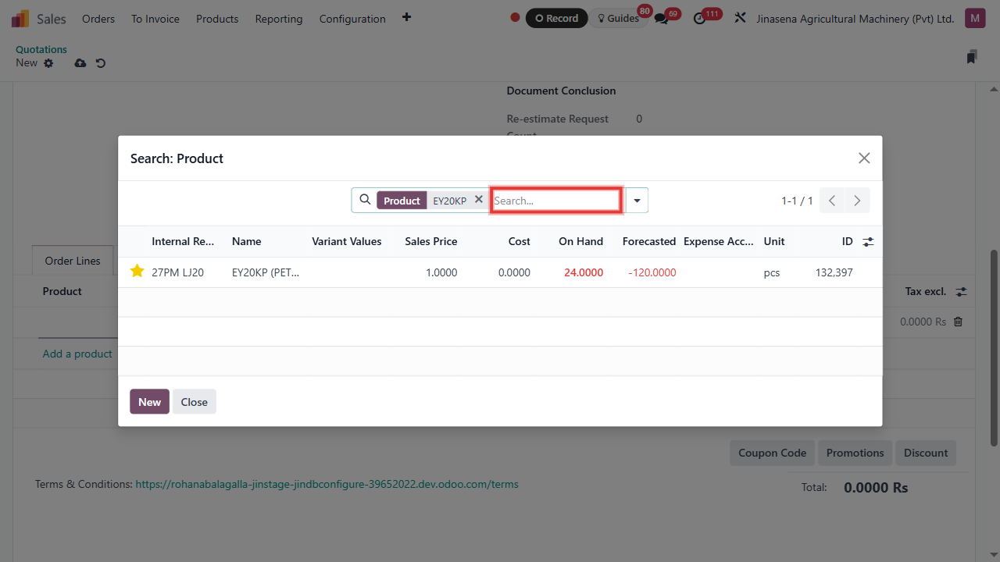

# Cash Sales Order - Serial — User Manual (English)

Step-by-step guide to creating a Cash sales order for a serial-number product: create the quotation, confirm it, add a new serial number on the delivery, validate the delivery, create the invoice and register the cash payment.

Generated from an Odoo Tour Recorder export, replayed with Playwright, and screenshotted at every step.

---

## 1. Open the Sales app

On the Odoo home screen, click the **Sales** icon to open the Sales app.

_Why: every sale starts in the Sales app. Check: the Sales menu (Orders, To Invoice, Products, Reporting...) appears across the top._

---

## 2. Open the Orders menu

Click **Orders** in the top menu. A small dropdown opens.

_Why: the Orders menu groups quotations and sales orders. Check: the dropdown shows Quotations._

---

## 3. Open the Quotations list

Click **Quotations** in the dropdown.

_Why: a quotation is the draft of a sale; it becomes a Sales Order when you confirm it. Check: the list of existing quotations opens._

---

## 4. Start a new quotation

Click the **New** button at the top left.

_Check: a blank quotation form opens._

---

## 5. Find the customer

Click the **Customer** field and start typing the customer name (for example "abc").

_Why: the list narrows as you type. Tip: for a Cash sale, use a Cash customer._

---

## 6. Select the customer

Click the customer you want in the dropdown list.

_Check: the customer name and address appear on the form, and the Invoice and Delivery Address fill in automatically. Watch out: a Cash customer cannot be changed to Credit later._

---

## 7. Set the payment type to Cash

In **Order Payment Type**, choose **Cash**.

_Why: this tells Odoo the customer pays immediately. Check: the field shows "Cash"._

---

## 8. Set the quotation type to Sales

In **Quotation Type**, choose **Sales**.

_Check: the field shows "Sales". Watch out: the quotation cannot be saved if this field is empty._

---

## 9. Add a product line

Under the **Order Lines** tab, click **Add a product**.

_Check: a new empty line appears and the Product field is ready for typing._

---

## 10. Open the Product field

Click the **Product** field on the new line. A dropdown with a few products opens.

_Tip: the dropdown shows only the first few products; use "Search More..." to see them all._

---

## 11. Click "Search More..."

At the bottom of the dropdown, click **Search More...**.

_Check: a larger window opens with a full product list and a search bar._

---

## 12. Search for the product

In the search bar of that window, type the product code, for example **EY20KP**, and press Enter.

_Tip: typing a part of the name or code is enough. Check: the list shrinks to the matching product._

---

## 13. Select the serial-number product

Click the product **[27PM LJ20] EY20KP (PETROL/KEROSENE) PUMP SHAFT ENGINE (LJ20)**.

_Why: this product is tracked by serial number, so each unit needs its own serial number at delivery. Check: the product appears on the order line._

---

## 14. Open the Other Info tab

Click the **Other Info** tab.

_Check: payment terms, sales team and warehouse fields are visible._

---

## 15. Open the Payment Terms field

Click the **Payment Terms** field.

_Check: a dropdown of payment terms opens._

---

## 16. Choose Immediate Payment

Click **Immediate Payment**.

_Why: this is a Cash order, so payment is due straight away. Check: the field shows "Immediate Payment"._

---

## 17. Open the Sales Team field

Click the **Sales Team** field.

_Check: a dropdown of sales teams opens._

---

## 18. Click "Search More..."

Click **Search More...** at the bottom of the dropdown.

_Check: a window with the full list of sales teams opens._

---

## 19. Select the Sales Team

Click **Colombo Sales Centre**.

_Check: the Sales Team field shows "Colombo Sales Centre" and the Warehouse is filled in automatically._

---

## 20. Check the Warehouse

Look at the **Warehouse** field. Odoo has already filled it in from the Sales Team: **JAM Warehouse Ekala- (JM-EK)**.

_Why: the goods are delivered from this warehouse. Tip: if the field is empty, click it and choose Search More... (next steps)._

> **Note:** this step was adapted from the recorded tour — see REVIEW.md.

---

## 21. If the Warehouse is empty: click "Search More..."

Only if the Warehouse field is empty: click the field and choose **Search More...** at the bottom of the dropdown.

_Check: the list of warehouses opens. In this example the field was already filled, so you can skip this step._

> **Note:** this step was adapted from the recorded tour — see REVIEW.md.

---

## 22. If the Warehouse is empty: select it

Click **JAM Warehouse Ekala- (JM-EK)** in the list.

_Check: the Warehouse field shows JAM Warehouse Ekala- (JM-EK)._

> **Note:** this step was adapted from the recorded tour — see REVIEW.md.

---

## 23. Confirm the order

Click the **Confirm** button at the top.

_Why: this turns the quotation into a confirmed Sales Order and creates the delivery. Check: the status changes to "Sales Order" and a Delivery smart button appears._

---

## 24. Open the delivery

Click the **Delivery** smart button at the top of the order.

_Check: the delivery transfer (for example JM-EK/OUT/00001) opens._

---

## 25. Open the serial number details

On the product line, click the **list icon** at the right end of the line.

_Why: a serial-number product must have a serial number assigned before it can be delivered. Check: the "Open: Stock move" window opens._

---

## 26. Add a serial number line

Click **Add a line** in that window.

_Check: a list of serial numbers already in stock opens, with a **New** button._

---

## 27. Create a new serial number

Click **New**.

_Check: the "Create Move Line" window opens with a Lot/Serial Number field._

---

## 28. Enter the new serial number

Click the **Lot/Serial Number** field and type the new serial number.

_Tip: each serial number must be unique for the product._

---

## 29. Create the serial number

Click **Create "<your serial number>"** in the dropdown.

_Check: the serial number is accepted and the field shows it._

---

## 30. Serial number added

The new serial number now shows in the **Lot/Serial Number** field. If it does not, press **Enter**.

_Check: the field shows your serial number and a small arrow icon beside it._

> **Note:** this step was adapted from the recorded tour — see REVIEW.md.

---

## 31. Save the move line

Click **Save & Close**.

_Check: the Create Move Line window closes._

---

## 32. Save the serial number

In the "Open: Stock move" window, click **Save**.

_Check: the window closes and the line now shows the quantity._

---

## 33. Save the delivery

Click the **Save** (cloud) icon at the top of the delivery.

_Check: the delivery is saved with the serial number._

---

## 34. Validate the delivery

Click **Validate**.

_Why: this hands the goods to the customer and takes them out of stock. Check: the status bar moves to **Done** (see the next screenshot). Watch out: Odoo refuses to deliver a serial number that has no stock, so the serial number must be in stock first._

---

## 35. Go back to the sales order

The delivery is now **Done**. Click the sales order number at the top left (next to "Quotations") to go back to the order.

_Check: the order opens and shows an invoice button._

---

## 36. Create the invoice

Click **Create Invoice**.

_Check: the invoice window or the draft invoice opens._

---

## 37. Confirm the invoice

Click **Confirm**.

_Why: this posts the invoice. Check: the invoice status becomes "Posted"._

---

## 38. Register the payment

Click **Register Payment**.

_Check: the payment window opens._

---

## 39. The payment window opens

The **Register Payment** window opens. It shows the Journal, the Payment Method, the Amount and the Payment Date.

_Check: the Amount equals the invoice total. Watch out: the Journal may be pre-filled with a bank journal; for a cash sale you change it in the next steps._

> **Note:** this step was adapted from the recorded tour — see REVIEW.md.

---

## 40. Open the Journal field

Click the **Journal** field to choose where the payment is recorded.

_Check: a short list of journals opens._

---

## 41. Find the cash journal

Look for **Customer Receipts - Cash** in the list.

_Tip: if it is not in the short list, choose Search More... at the bottom._

> **Note:** this step was adapted from the recorded tour — see REVIEW.md.

---

## 42. Click "Search More..."

Click **Search More...** at the bottom of the dropdown.

_Check: a window with the journals opens._

---

## 43. Select Customer Receipts - Cash

Click **Customer Receipts - Cash**.

_Why: a cash payment is recorded on the cash journal. Check: the Journal field shows "Customer Receipts - Cash"._

---

## 44. Create the payment

Click **Create Payment**.

_Check: the payment is created and the invoice shows it as paid or in payment._

---

## 45. Open the source sales order

Click the **Sales Orders** smart button.

_Check: the original sales order opens._

---

## 46. Open the invoice

Click the **Invoices** smart button.

_Check: the invoice linked to the order opens._

---

## 47. The customer invoice

The customer invoice opens. At the top right the status bar shows **Posted**.

_Check: the invoice number (for example FTI/2026/00602) and the customer are shown._

> **Note:** this step was adapted from the recorded tour — see REVIEW.md.

---

## 48. Invoice lines

Scroll down to the **Invoice Lines**. They list the serial-number product that was invoiced.

_Check: the line shows [27PM LJ20] EY20KP PUMP SHAFT ENGINE, quantity 1, and **Amount Due 0.0000** once the payment is registered._

> **Note:** this step was adapted from the recorded tour — see REVIEW.md.

---

## 49. Payment registered

The green **IN PAYMENT** ribbon at the top right of the invoice confirms that the payment was registered.

_Result: the sale is complete. Tip: "In Payment" changes to **Paid** once the payment is reconciled with the cash or bank statement._

> **Note:** this step was adapted from the recorded tour — see REVIEW.md.

---

