# Cash Sales Order - Serial — User Manual (English)

Step-by-step guide to selling a serial-number product to a cash customer: create the quotation, confirm it, give the unit its own serial number on the delivery, validate the delivery, invoice the customer and record the cash payment. Before you start: you need access to the Sales app, an existing cash customer, and a product that is tracked by serial number (this guide uses [27PM LJ20] EY20KP PUMP SHAFT ENGINE). A serial number is a unique code that identifies one single unit (like a chassis number), so every unit you deliver needs its own, and it must not be used twice. In every screenshot the red box shows exactly what to click or fill in.

Generated from an Odoo Tour Recorder export, replayed with Playwright, and screenshotted at every step.

---

## 1. Open the Sales app from the Odoo home screen to start a new sale

Log in to Odoo. On the home screen you will see a grid of app icons. Find the **Sales** icon (red box) and click it. The Sales app opens and its menu appears across the top of the screen.

_Why: every sale starts in the Sales app. Check: you see the menu Orders, To Invoice, Products, Reporting, Configuration. Watch out: if the Sales icon is missing, your user has no Sales access, so ask your administrator._

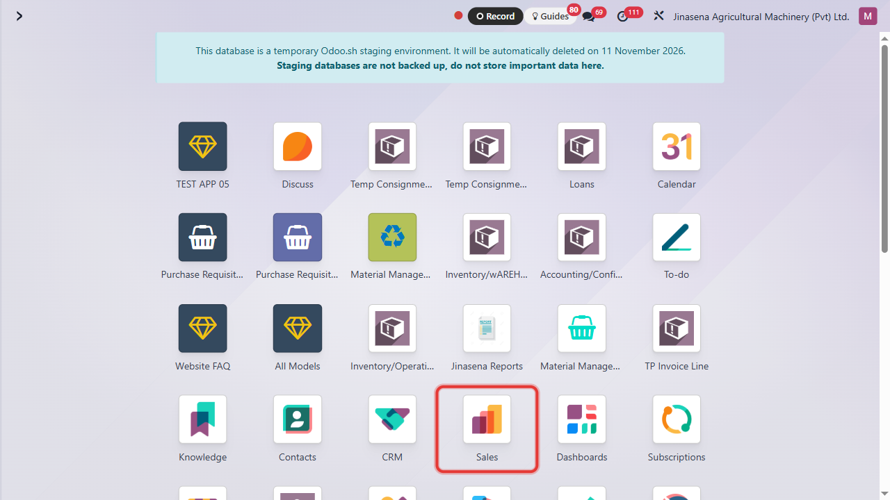

---

## 2. Click Orders in the top menu to see the order options

Look at the menu bar at the top of the screen. Click **Orders**. A small dropdown opens just below it.

_Why: the Orders menu groups quotations and sales orders together. Check: the dropdown lists Quotations._

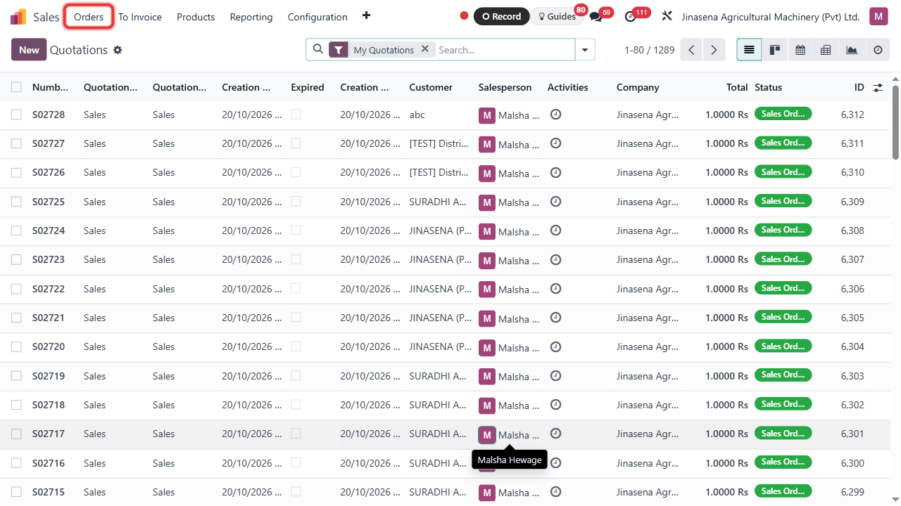

---

## 3. Click Quotations to open the list of existing quotations

In the dropdown, click **Quotations**. A list opens with the quotations that already exist, showing the customer, the date and the status of each one.

_Why: a quotation is the draft of a sale. It only becomes a Sales Order when you click Confirm. Check: you see a list with a **New** button at the top left._

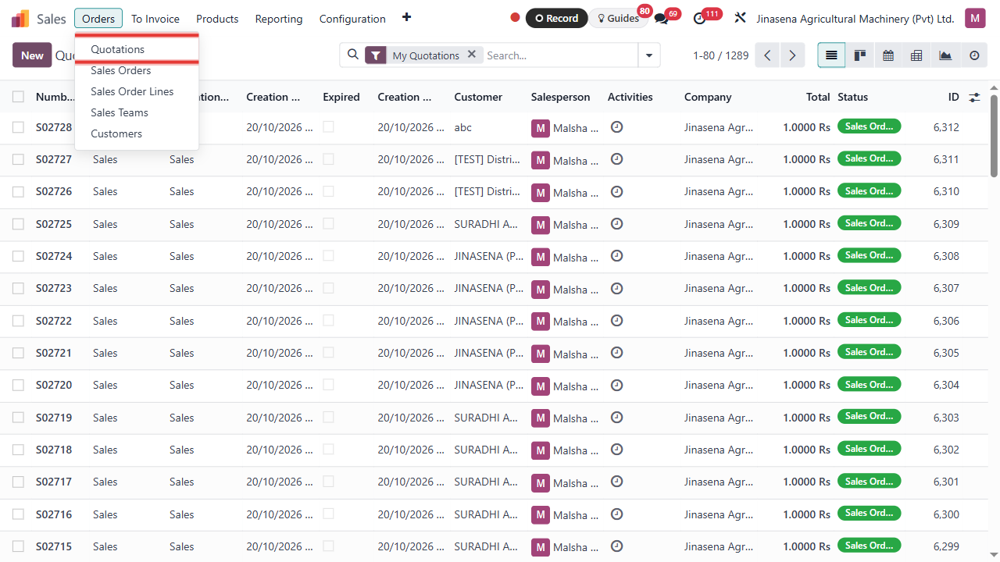

---

## 4. Click New to start a blank quotation

At the top left of the list, click the purple **New** button. A blank quotation form opens.

_Check: the form shows the title "New" and empty fields such as Customer and Order Payment Type._

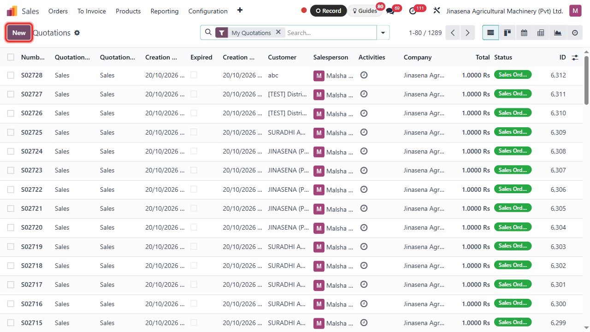

---

## 5. Click the Customer field and type the customer name to search for them

On the form, find the **Customer** field near the top left. Click it and type the customer name, or part of it (in this example **abc**). A list of matching customers opens below the field.

_Why: Odoo needs a customer to price the order and to print the invoice. Tip: you can search by name, phone or code. Watch out: for a cash sale choose a cash customer; if the customer does not exist, create them first._

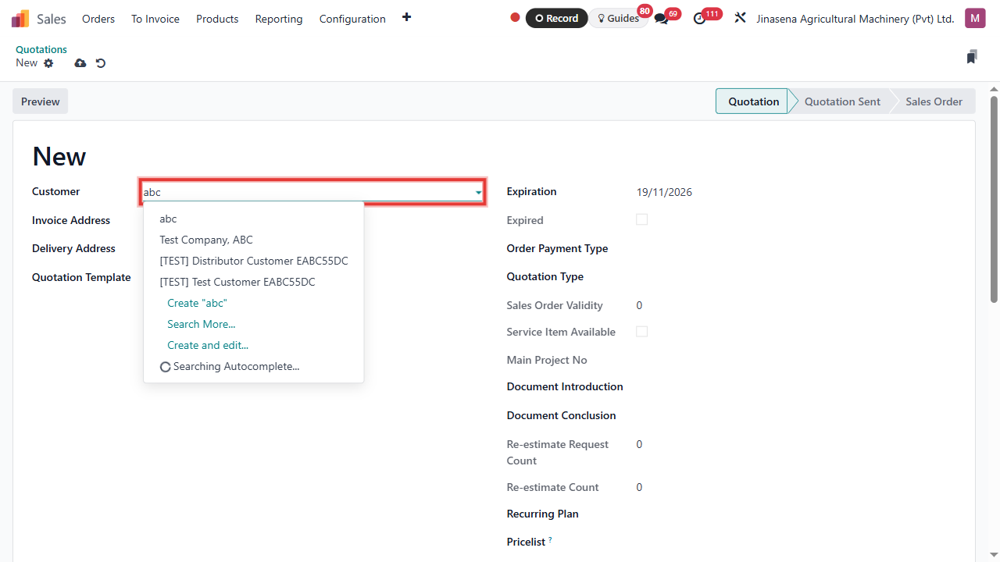

---

## 6. Select the correct customer from the search results

Look through the list and click the correct customer (red box). The name now shows in the Customer field, and the Invoice Address and Delivery Address fill in by themselves.

_Check: the customer name and address appear, and the Invoice Address and Delivery Address are filled. Wrong customer? Click the field again and choose another one before saving. Watch out: a cash customer cannot be changed to Credit later on this order._

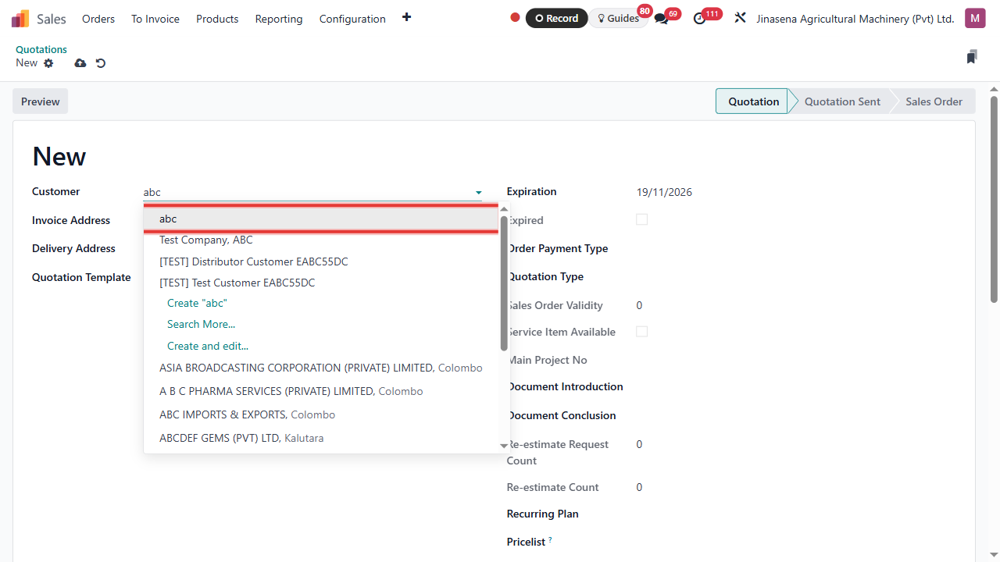

---

## 7. Set Order Payment Type to Cash because the customer pays immediately

Find **Order Payment Type** on the right side of the form and choose **Cash** from the dropdown.

_Why: this tells Odoo the customer pays at once, not later on credit. Cash orders normally need no approval. Check: the field shows "Cash"._

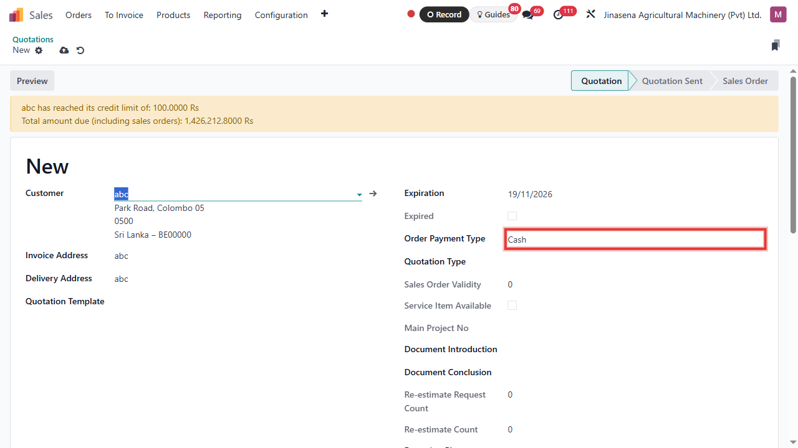

---

## 8. Set Quotation Type to Sales to mark this as a normal product sale

Just below, open **Quotation Type** and choose **Sales**.

_Check: the field shows "Sales". Watch out: Odoo will not let you save the quotation while this field is empty._

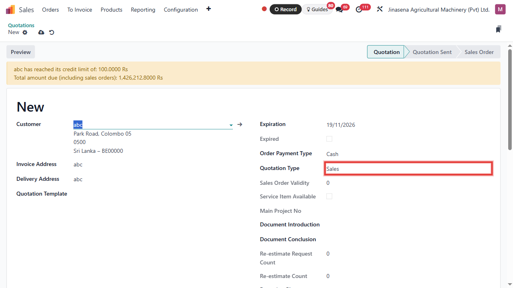

---

## 9. Click Add a product to add a new row to the order lines

Scroll down to the **Order Lines** tab at the bottom of the form and click **Add a product**. A new empty row appears.

_Check: the new row is ready, with an empty Product cell._

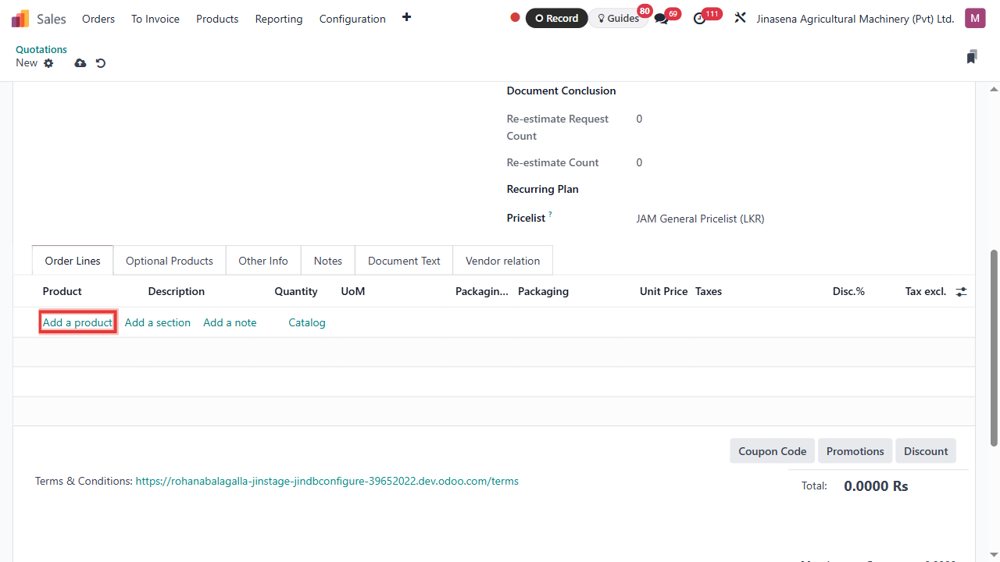

---

## 10. Click the Product field on the new row to open the list of products

Click the **Product** cell of the new row. A short dropdown opens with the first few products and a **Search More...** option at the bottom.

_Why: the dropdown only shows the first few products, so the product you want is usually not in it yet. Tip: you can also type a few letters of the product code straight into this cell._

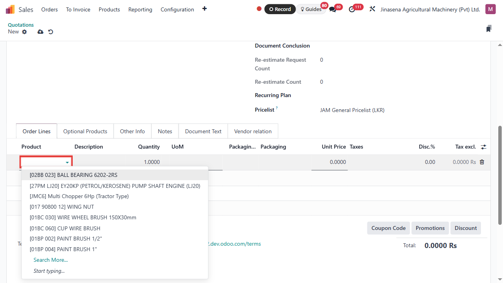

---

## 11. Click Search More... to open the full product list

At the bottom of the dropdown, click **Search More...** (red box). A larger window opens with the complete product list and a search bar at the top.

_Check: the "Search: Product" window is open and shows many products._

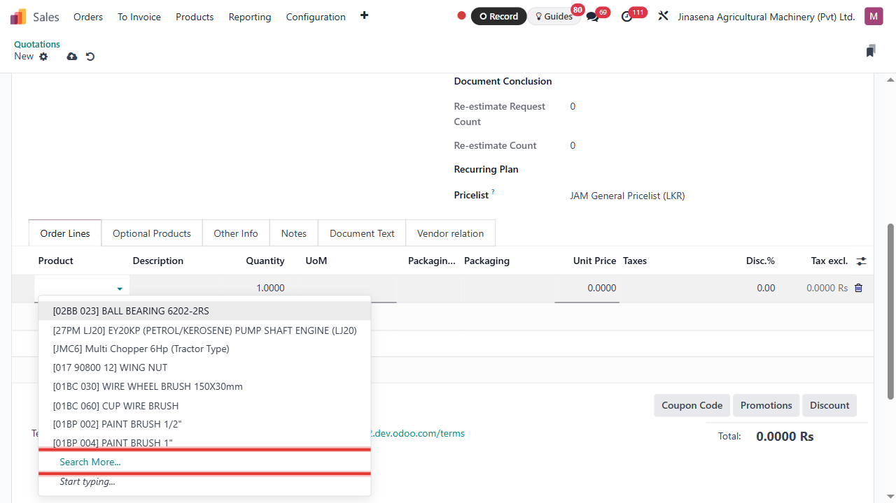

---

## 12. Find and select the serial-number product

In the product window, find the row **[27PM LJ20] EY20KP (PETROL/KEROSENE) PUMP SHAFT ENGINE (LJ20)** and click it (red box). If you do not see it, type **EY20KP** in the search bar at the top of the window and press **Enter**; the list shrinks to the matching product. The window closes and the product appears on the order line.

_Why: this product is tracked by serial number, so each unit needs its own serial number when you deliver it (steps 24 to 32). Tip: part of the name or code is enough in the search bar. Check: the order line shows the product, quantity 1 and a price._

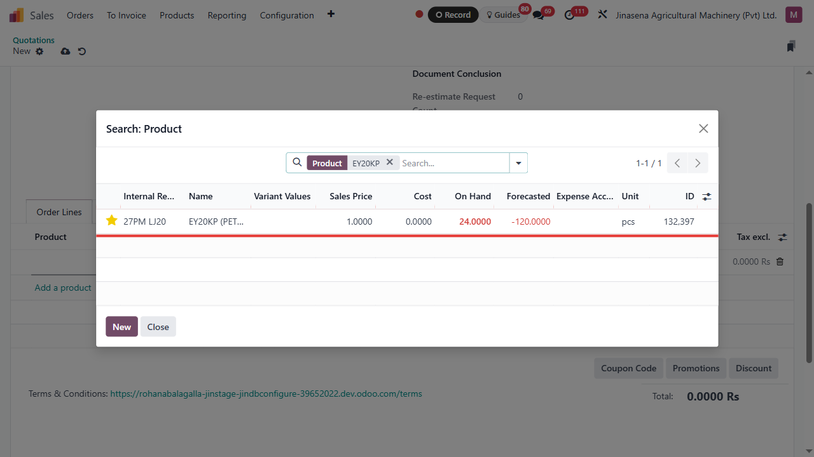

---

## 13. Open the Other Info tab to fill in payment terms, sales team and warehouse

Click the **Other Info** tab (next to Order Lines). It holds the payment, delivery and sales team details of the order.

_Check: you see fields such as Payment Terms, Salesperson, Sales Team and Warehouse._

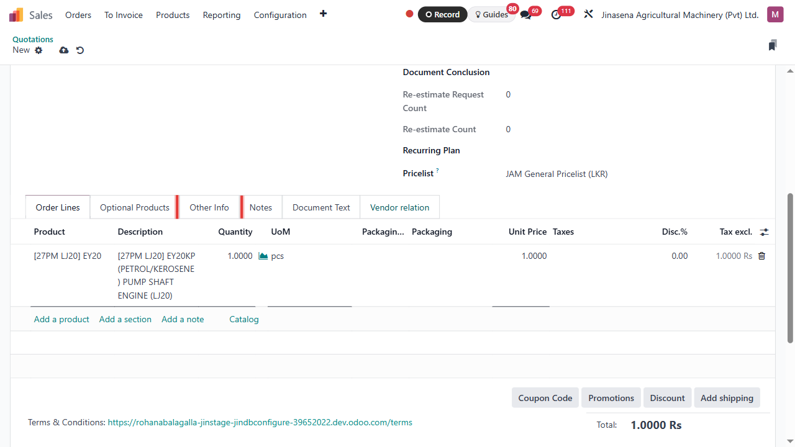

---

## 14. Check the Payment Terms that Odoo filled in from the customer

When you selected the customer, Odoo **filled in the Payment Terms automatically** from that customer's record. Open the **Other Info** tab and look at the **Payment Terms** field (red box) to read the value. You can click the field to see the other payment terms in the dropdown.

_Why: the payment terms decide the due date printed on the invoice. Double-check: for a cash sale the value must be **Immediate Payment**. If it shows something else (for example 30 Days), change it in the next step. Check: the field shows a payment term and the dropdown lists the alternatives._

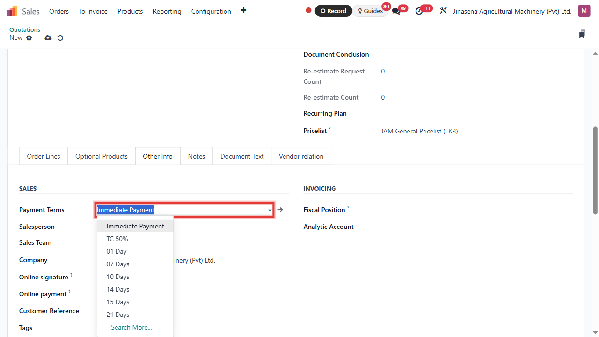

---

## 15. If the Payment Terms is not Immediate Payment, select it

If the field already shows **Immediate Payment**, there is nothing to change. Otherwise, click **Immediate Payment** (red box) in the dropdown.

_Why: on a cash order the money is due at once, so the invoice must not get a later due date. Check: the field shows "Immediate Payment". Watch out: a wrong payment term gives the invoice a future due date._

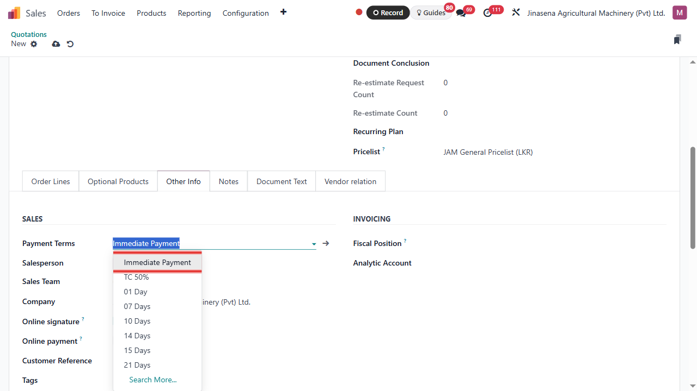

---

## 16. Click the Sales Team field to choose the team making this sale

Click the **Sales Team** field. A dropdown opens with a few teams.

_Why: the sales team decides the sales reports the order is counted in and, here, also the delivery warehouse._

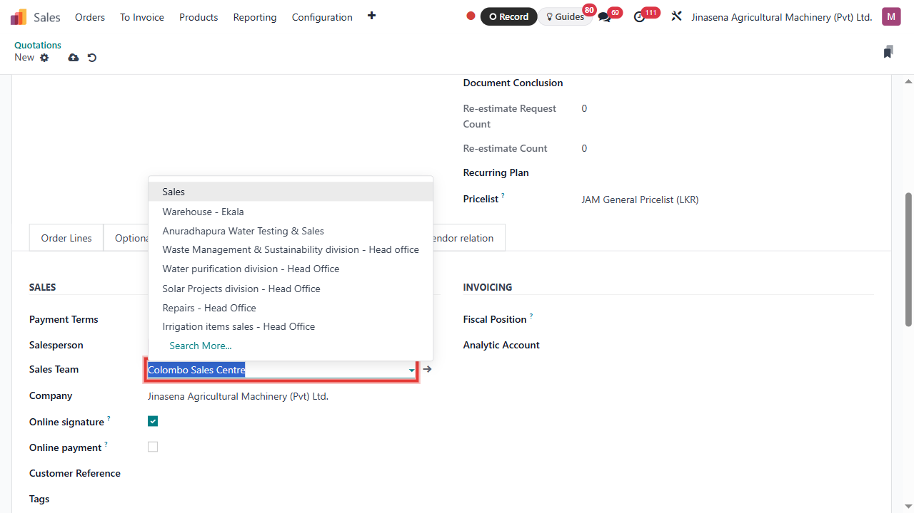

---

## 17. Click Search More... to see every sales team

At the bottom of the dropdown, click **Search More...**. A window opens with the full list of sales teams.

_Check: the list of teams is shown. Tip: you can also type the team name directly in the field._

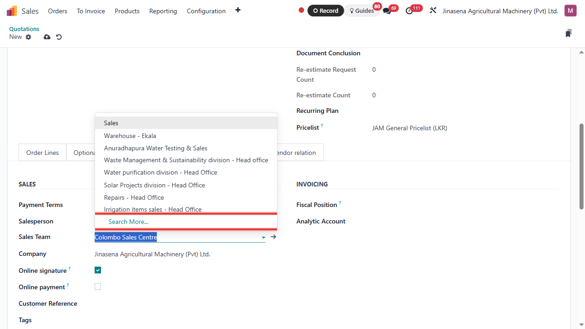

---

## 18. Select the Colombo Sales Centre team

Click **Colombo Sales Centre** (red box). The window closes and the team appears in the field.

_Check: the Sales Team field shows "Colombo Sales Centre". Odoo now also fills the Warehouse on its own._

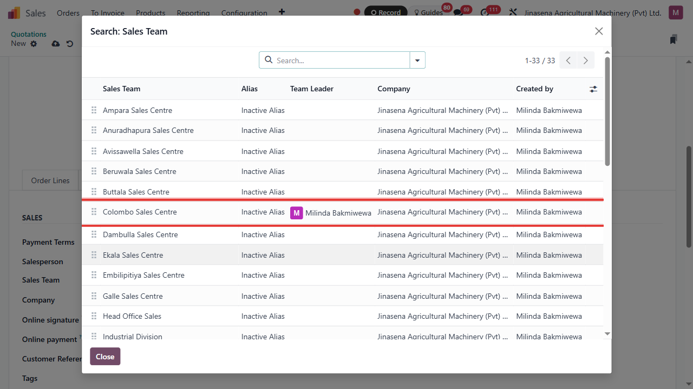

---

## 19. Check that the Warehouse is correct

Look at the **Warehouse** field in the Delivery section (red box). Odoo has already filled it in from the Sales Team: **JAM Warehouse Ekala- (JM-EK)**.

_Why: the goods will be taken out of stock from this warehouse. Tip: if the field is empty, click it and use the next two steps to pick the warehouse._

> **Note:** this step was adapted from the recorded tour — see REVIEW.md.

---

## 20. Only if the Warehouse is empty: click Search More...

If the Warehouse field was empty, click it and choose **Search More...** at the bottom of the dropdown.

_Check: a list of warehouses opens. In this example the Warehouse was already filled, so you can skip this step._

> **Note:** this step was adapted from the recorded tour — see REVIEW.md.

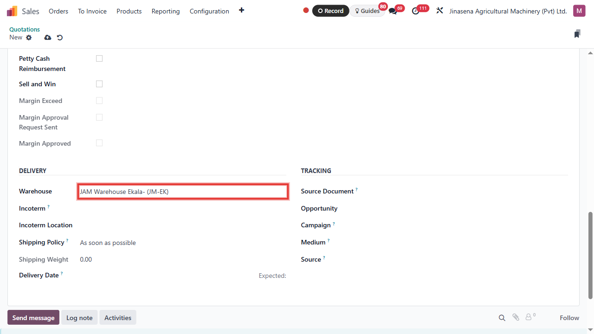

---

## 21. Confirm the delivery Warehouse (JAM Warehouse Ekala- (JM-EK))

The **Warehouse** field is populated automatically from the Sales Team you selected, so in most cases no action is required. Verify that it reads **JAM Warehouse Ekala- (JM-EK)** (red box). Only if the field is empty, open it and select **JAM Warehouse Ekala- (JM-EK)** from the list.

_Why: the Warehouse determines which stock location the goods are reserved and picked from, and which delivery document (for example JM-EK/OUT/...) is created when the order is confirmed. Check: the Warehouse shows JAM Warehouse Ekala- (JM-EK). Watch out: a warehouse that does not hold the product may prevent Odoo from reserving the stock for the delivery._

> **Note:** this step was adapted from the recorded tour — see REVIEW.md.

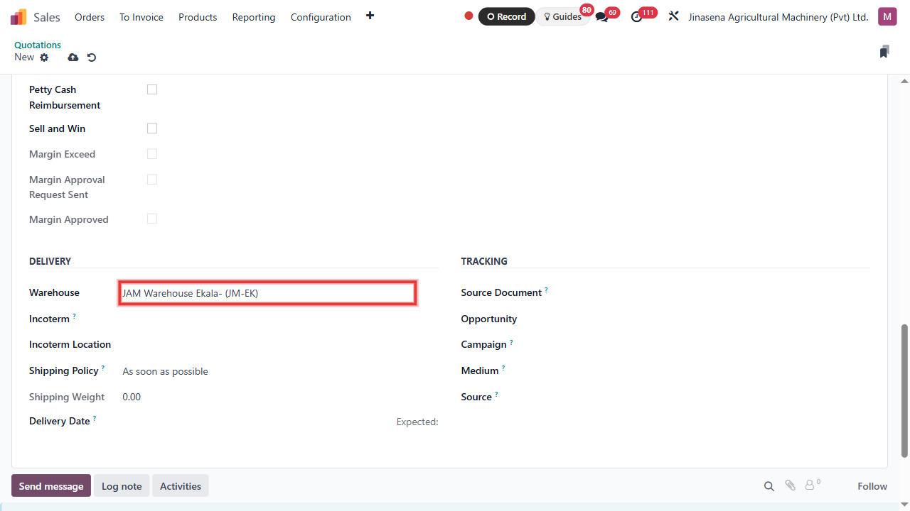

---

## 22. Click Confirm to turn the quotation into a Sales Order

At the top of the form, click the purple **Confirm** button (red box). Odoo saves the quotation and turns it into a confirmed Sales Order.

_Why: confirming makes the order official and creates the delivery that you will process next. Check: the status bar moves to "Sales Order", the number changes to S0..., and a **Delivery** button appears at the top._

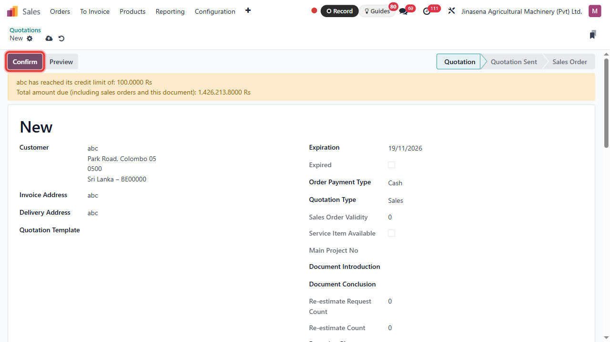

---

## 23. Click the Delivery button to open the delivery

At the top of the order, click the **Delivery** smart button (red box). The delivery transfer opens, for example JM-EK/OUT/01060.

_Why: the delivery is the document your warehouse uses to hand the goods to the customer. Check: you see the delivery with the product line and the status "Waiting"._

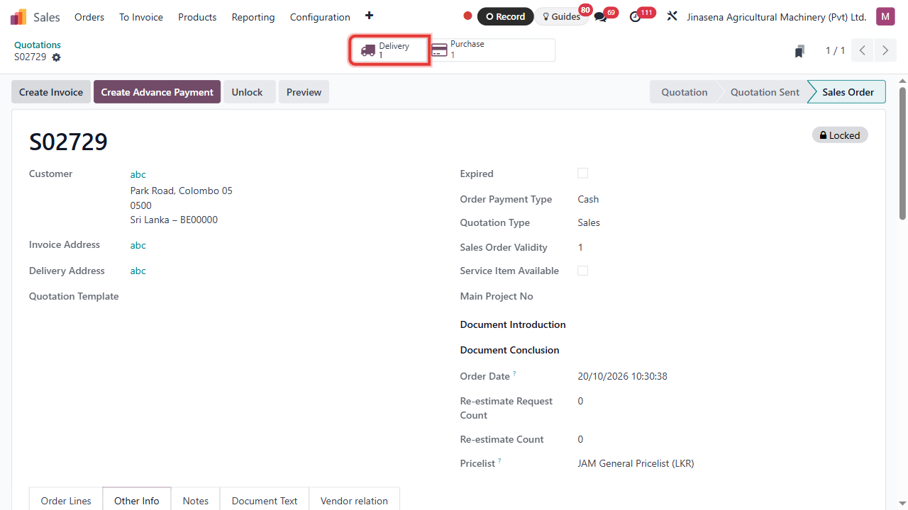

---

## 24. Click the list icon on the product line to enter the serial number

On the product line in the Operations tab, click the small **list icon** at the right end of the line (red box). A window titled "Open: Stock move" opens.

_Why: a serial-number product cannot be delivered until each unit has its serial number. This window is where you give it one. Check: the window shows the product, the Demand quantity and an **Add a line** link._

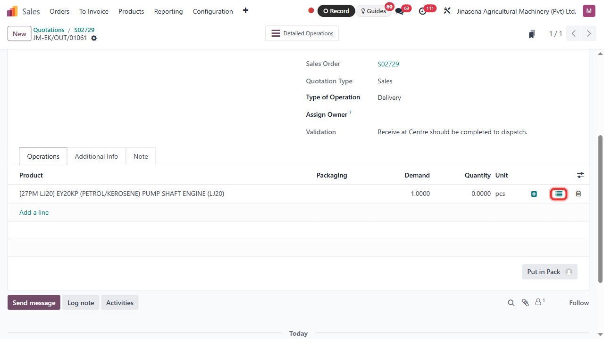

---

## 25. Click Add a line to add a serial number

In that window, click **Add a line**. A second window lists the serial numbers that are already in stock, with a **New** button at the bottom.

_Tip: if the serial number you need is already in the list, you can simply select it. This guide creates a brand new one. Check: the "Add line" list is open._

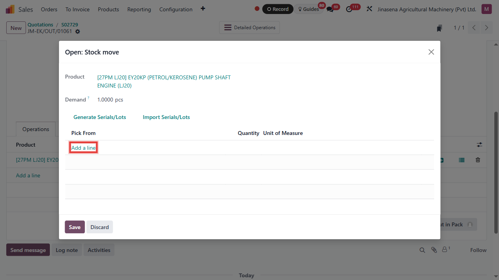

---

## 26. Click New to create a new serial number

Click the purple **New** button at the bottom of the list. A small window titled "Create Move Line" opens.

_Check: the window shows a **Lot/Serial Number** field and a yellow warning about negative stock. Do not worry about the warning: it simply says this serial number has no stock yet._

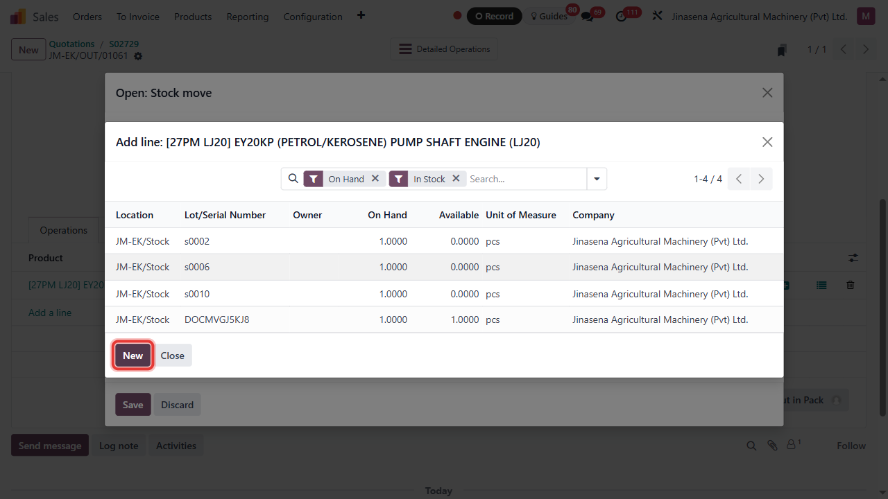

---

## 27. Type the new serial number in the Lot/Serial Number field

Click the **Lot/Serial Number** field and type the new serial number, for example **DOC12345**. A dropdown appears below with the option Create "your serial number".

_Tip: use the code that is written on the unit itself or on its label. Watch out: every serial number must be unique for the product. Odoo will not accept one that already exists._

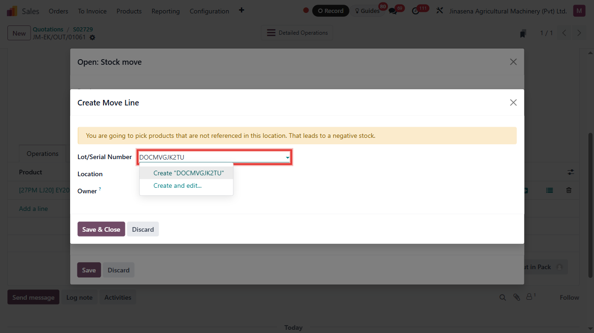

---

## 28. Click Create to register the new serial number

In the dropdown, click **Create "your serial number"** (red box). Odoo creates the serial number and puts it in the field.

_Check: the field now shows your serial number, with a small arrow icon at its right._

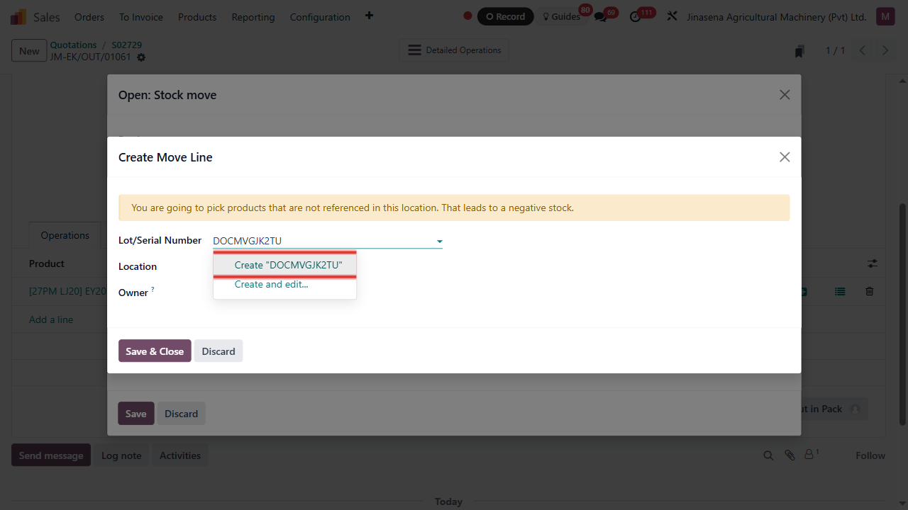

---

## 29. Check that the serial number is in the field

Look at the **Lot/Serial Number** field (red box). Your serial number is shown there. If it is not, press **Enter** to confirm it.

_Check: the serial number is visible and the "Save & Close" button is available at the bottom._

> **Note:** this step was adapted from the recorded tour — see REVIEW.md.

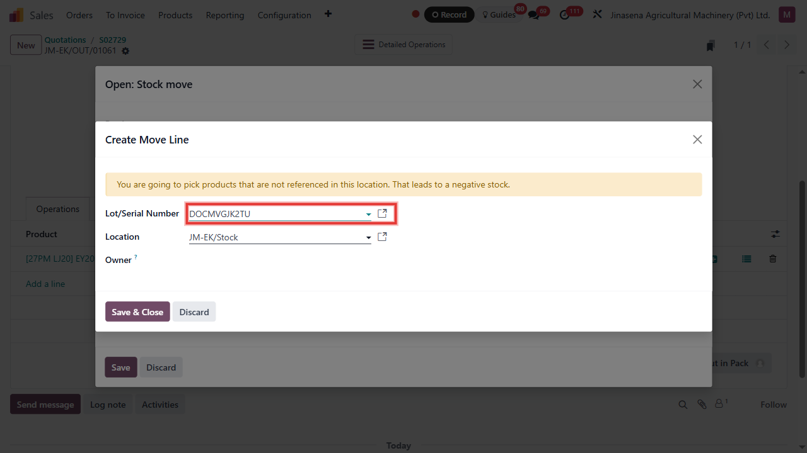

---

## 30. Click Save & Close to keep the serial number

Click **Save & Close** (red box) at the bottom of the small window. It closes and you return to the "Open: Stock move" window.

_Check: the Create Move Line window is gone and the stock move now lists a line with your serial number and quantity 1._

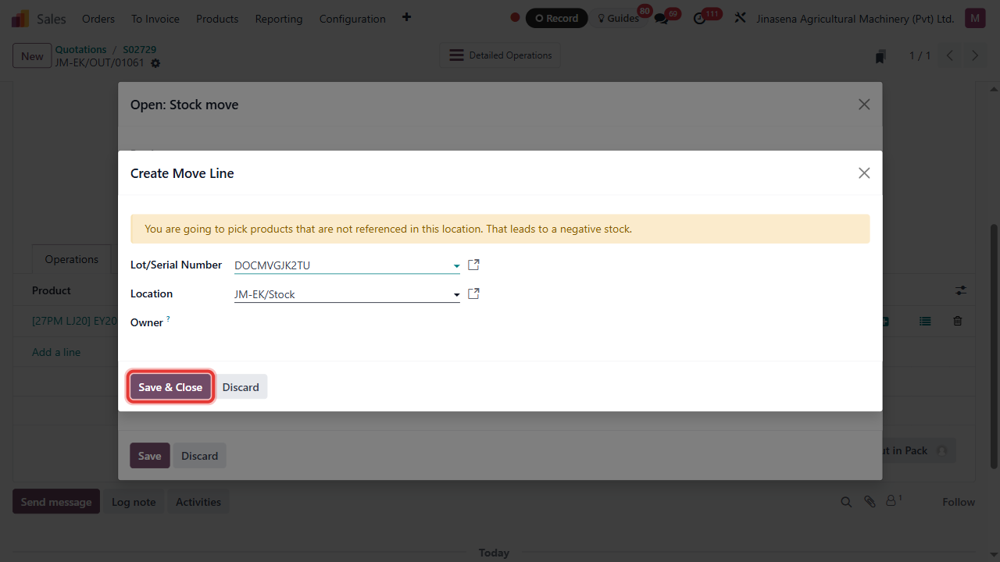

---

## 31. Click Save to attach the serial number to the delivery

In the "Open: Stock move" window, click **Save** (red box). The window closes and you are back on the delivery.

_Check: the product line on the delivery now shows quantity 1.0000 in the Quantity column._

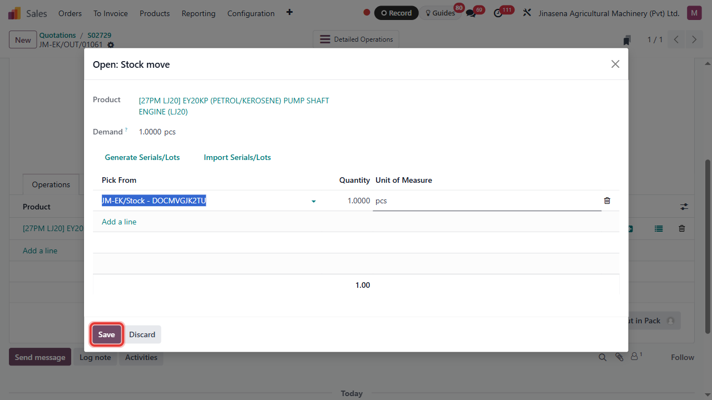

---

## 32. Save the delivery

If the **Save** (cloud) icon is shown at the top left next to the delivery number, click it so that the delivery is saved with the serial number.

_Check: the cloud icon disappears. Tip: if it was not shown, the delivery was saved already, so go on to the next step._

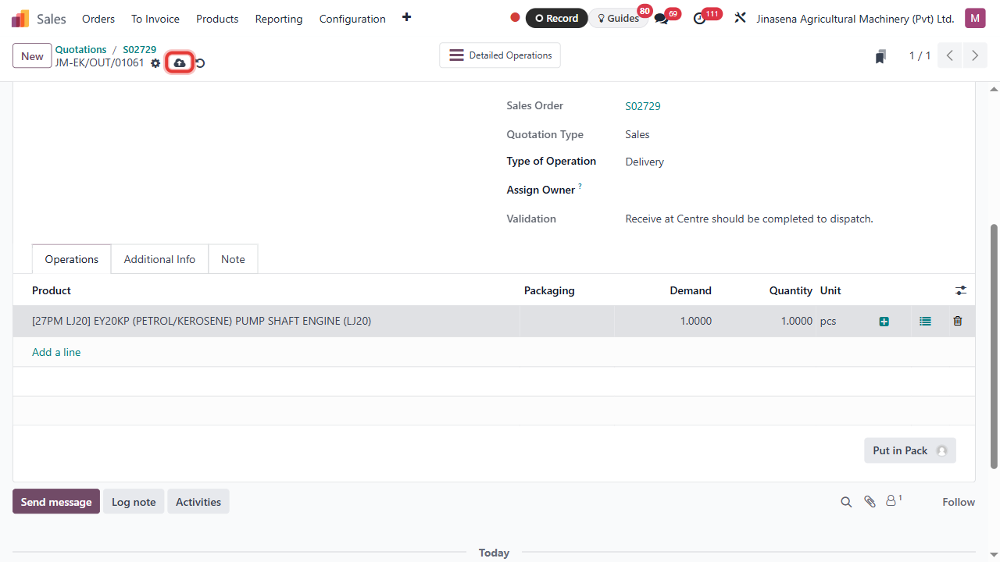

---

## 33. Click Validate to deliver the goods

Click the purple **Validate** button at the top left (red box). If Odoo asks a question, confirm it.

_Why: this hands the goods to the customer and takes the unit out of stock. Check: the status bar at the top right moves to **Done**. Watch out: Odoo refuses to deliver a serial number that has no stock ("negative stock"). Make sure the serial number is in stock before validating, or the delivery will not complete._

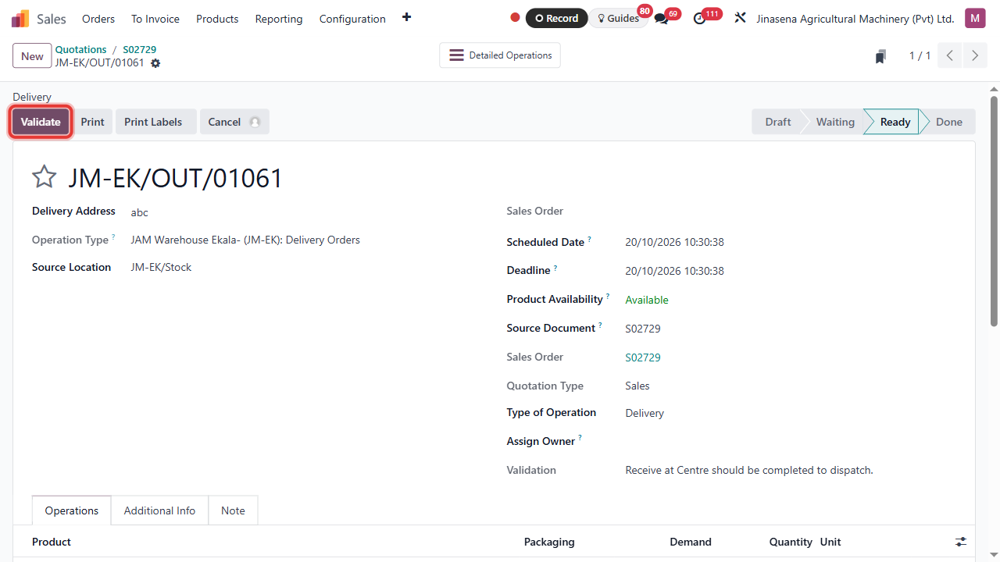

---

## 34. Go back to the sales order

The delivery is now **Done**. At the top left, click the sales order number (red box, for example S02729) to go back to the order.

_Check: the order opens again and now shows a **Create Invoice** button._

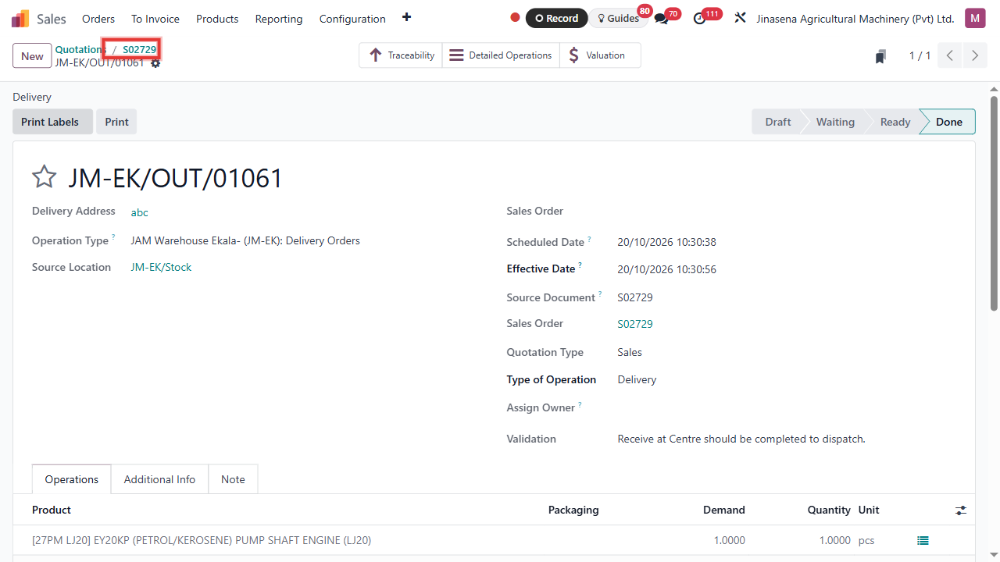

---

## 35. Click Create Invoice to bill the customer

Click **Create Invoice** (red box). If a small window asks which kind of invoice to create, keep the default "Regular invoice" and click **Create Draft Invoice**.

_Why: the invoice is the document you give the customer to ask for payment. Check: a draft invoice opens with the customer, the product and the amount._

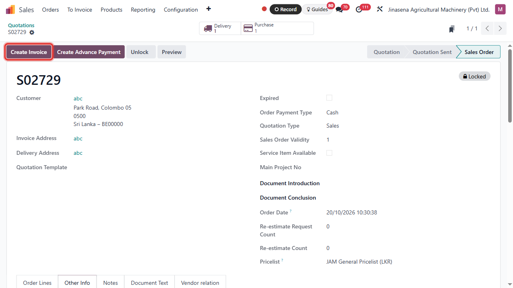

---

## 36. Click Confirm to post the invoice

On the draft invoice, click **Confirm** (red box). The invoice gets its final number, for example FTI/2026/00602.

_Why: a draft invoice has no accounting effect; confirming it records the sale in the books. Check: the status bar moves to **Posted** and a **Register Payment** button appears._

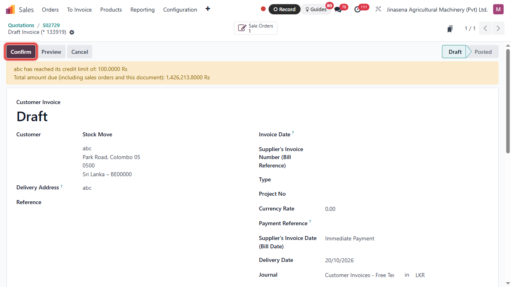

---

## 37. Click Register Payment to record the money received

Click **Register Payment** (red box) at the top of the invoice. A payment window opens.

_Why: this records that the customer has paid. Check: the Register Payment window opens._

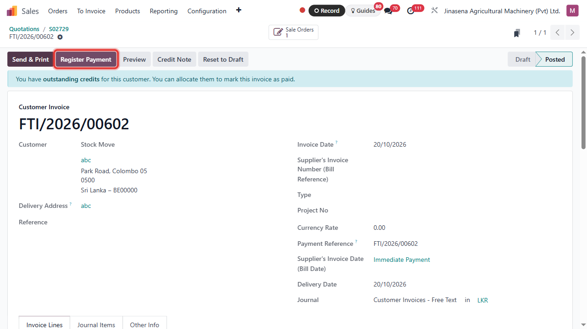

---

## 38. Review the Register Payment window

The **Register Payment** window shows the Journal, the Payment Method, the Amount and the Payment Date.

_Check: the Amount equals the invoice total and the Payment Date is today. Watch out: the Journal may be pre-filled with a bank journal. For a cash sale you must change it to the cash journal (next steps)._

> **Note:** this step was adapted from the recorded tour — see REVIEW.md.

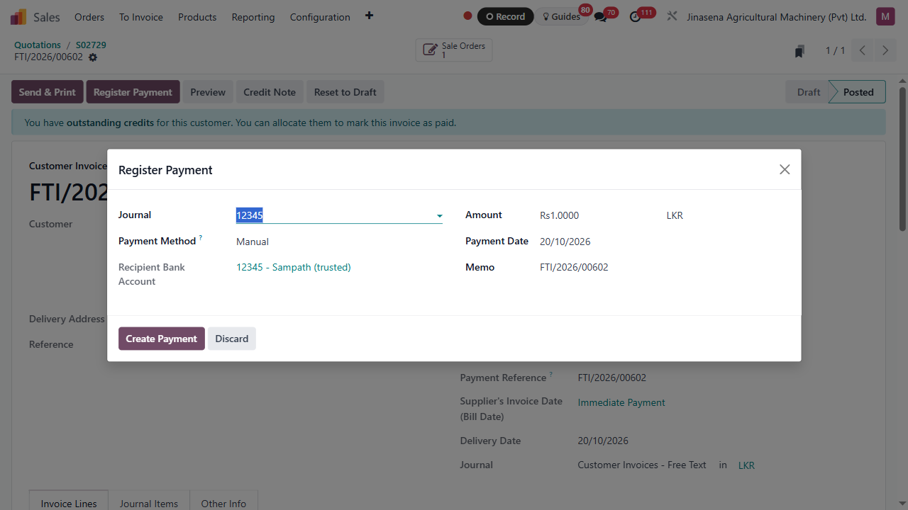

---

## 39. Click the Journal field to choose where the payment is recorded

Click the **Journal** field at the top left of the window. A short list of journals opens.

_Why: the journal decides which account the money goes to: cash or bank. Check: the list of journals is open._

---

## 40. Look for Customer Receipts - Cash in the journal list

In the list, look for **Customer Receipts - Cash**. It is the journal used for payments received in cash.

_Tip: if you do not see it in the short list, choose **Search More...** at the bottom of the list or type "Cash" in the field._

> **Note:** this step was adapted from the recorded tour — see REVIEW.md.

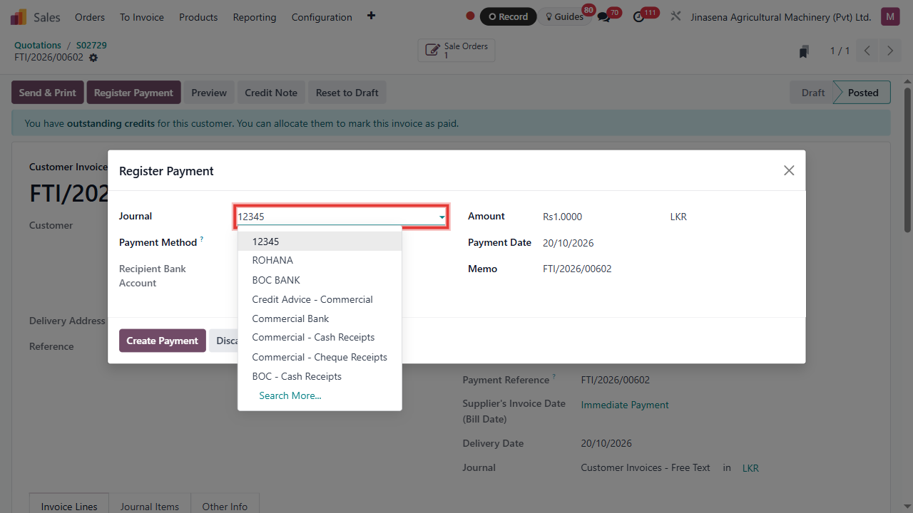

---

## 41. Click Search More... to see all the journals

At the bottom of the dropdown, click **Search More...**. A window opens with every journal.

_Check: the full list of journals is shown._

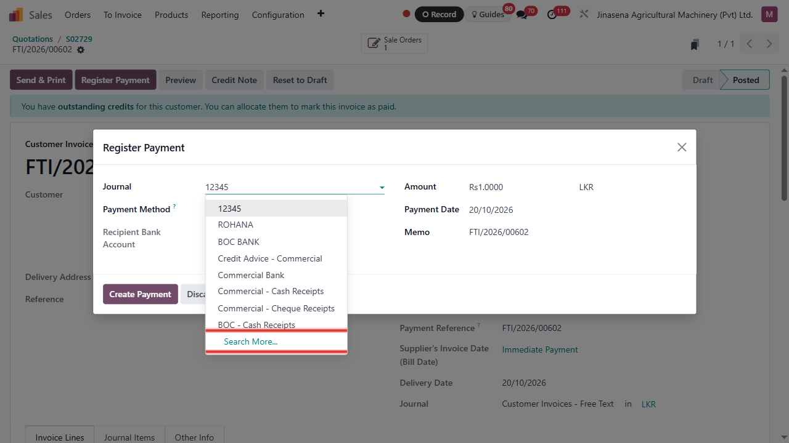

---

## 42. Select Customer Receipts - Cash

Click the row **Customer Receipts - Cash** (red box).

_Check: the Journal field now shows "Customer Receipts - Cash". Watch out: choosing a bank journal by mistake would record the money as a bank deposit._

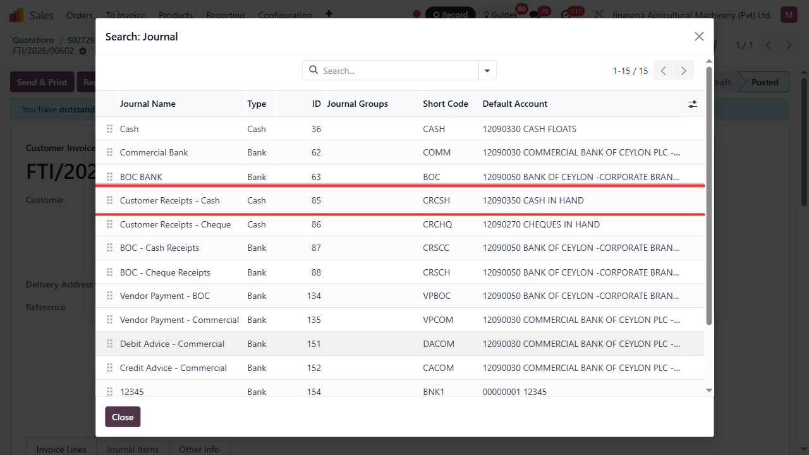

---

## 43. Click Create Payment to finish the payment

Click **Create Payment** (red box). The window closes and the invoice is updated.

_Check: a green **IN PAYMENT** ribbon appears at the top right of the invoice, or **PAID** if the payment is already reconciled._

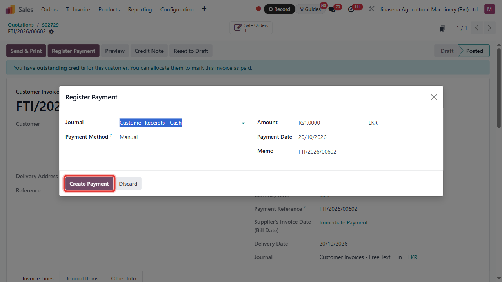

---

## 44. Click the Sale Orders button to see the original order

At the top of the invoice, click the **Sale Orders** button (red box). The sales order this invoice came from opens.

_Why: it lets you jump between the order and its invoice at any time. Check: the sales order opens._

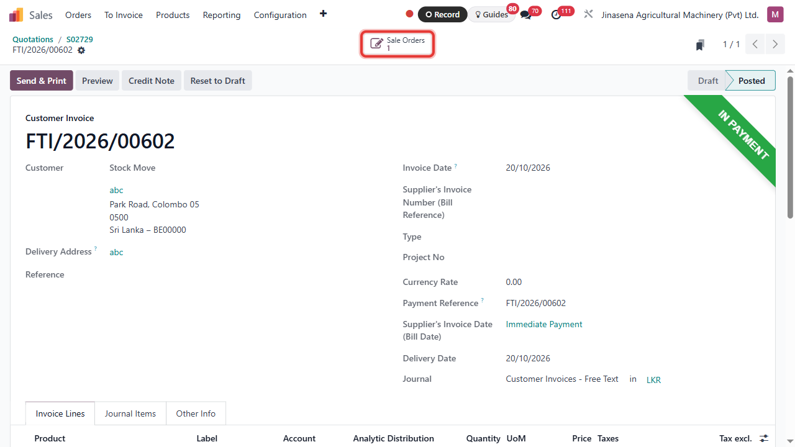

---

## 45. Click the Invoices button to return to the invoice

On the sales order, click the **Invoices** button (red box) to go back to the invoice.

_Check: the invoice opens again._

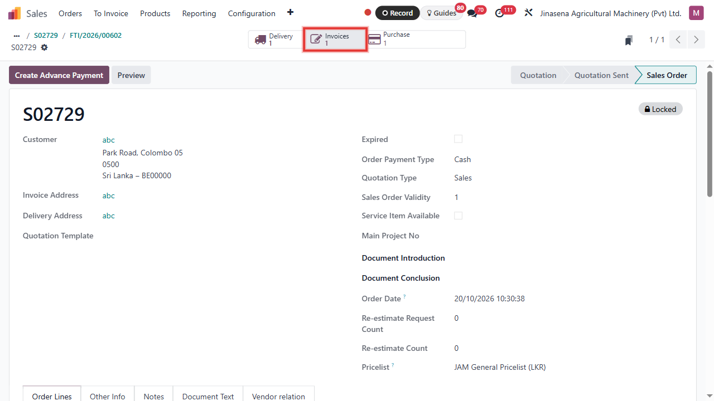

---

## 46. Review the finished customer invoice

The customer invoice is open. At the top right the status bar shows **Posted**, and the customer, the invoice number and the dates are shown.

_Check: the invoice number (for example FTI/2026/00602) and the customer name are correct._

> **Note:** this step was adapted from the recorded tour — see REVIEW.md.

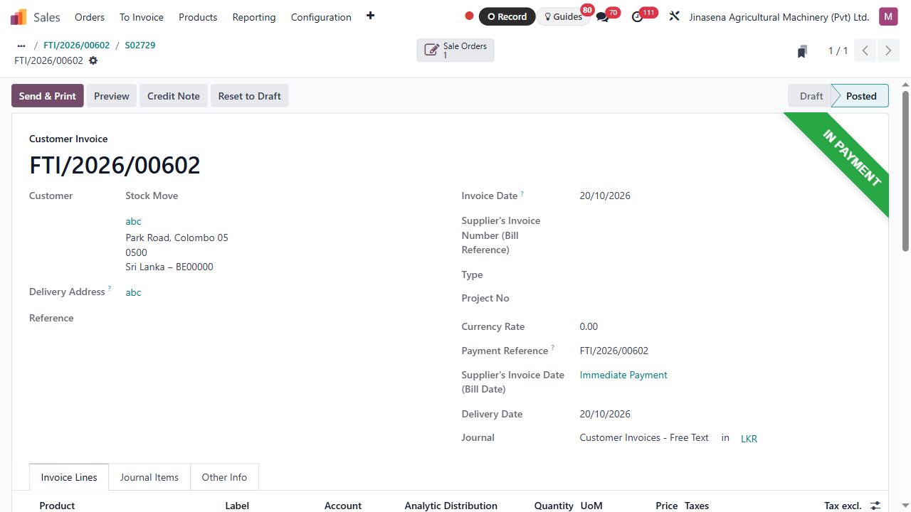

---

## 47. Check the invoice lines and the amount due

Scroll down to the **Invoice Lines**. They list the serial-number product you sold. At the bottom right you see the Total and the **Amount Due**.

_Check: the line shows [27PM LJ20] EY20KP PUMP SHAFT ENGINE, quantity 1, and the **Amount Due is 0.0000** because the customer has paid._

> **Note:** this step was adapted from the recorded tour — see REVIEW.md.

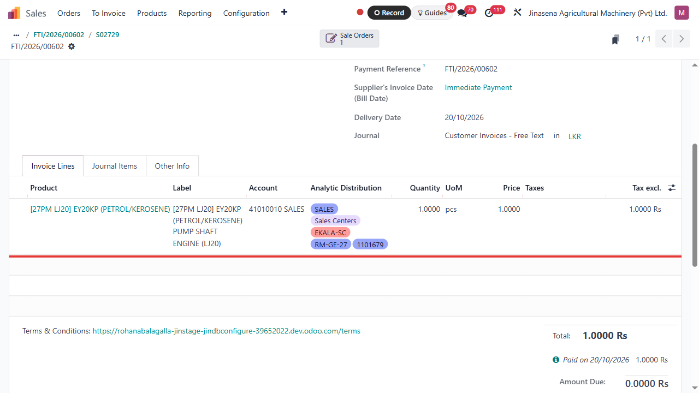

---

## 48. Confirm that the payment is registered

Look at the top right of the invoice: the green **IN PAYMENT** ribbon (red box) shows that the payment has been registered. The sale is now complete.

_Result: product delivered with its own serial number, customer invoiced, payment recorded. Tip: "In Payment" becomes **Paid** after the payment is reconciled with your cash or bank statement._

> **Note:** this step was adapted from the recorded tour — see REVIEW.md.

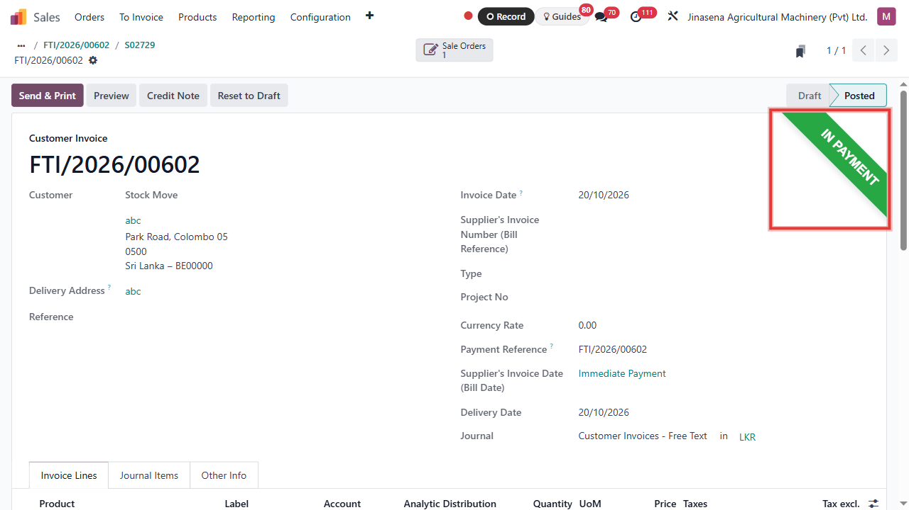

---

