# CASH SALES ORDER — User Manual (English)

Step-by-step guide to selling to a cash customer: create the quotation, confirm it, deliver the goods, invoice the customer and record the cash payment.

Generated from an Odoo Tour Recorder export, replayed with Playwright, and screenshotted at every step.

---

## 1. Open the Sales app from the Odoo home screen to start a new sale

Log in to Odoo. On the home screen you will see a grid of app icons. Find the **Sales** icon (a small bar-chart symbol) and click it. The Sales app opens, and its menu appears across the top of the screen.

_Why: every sale starts in the Sales app. Check: you should see the Quotations list afterwards. If the Sales tile is missing, your user has no Sales access, so ask your administrator._

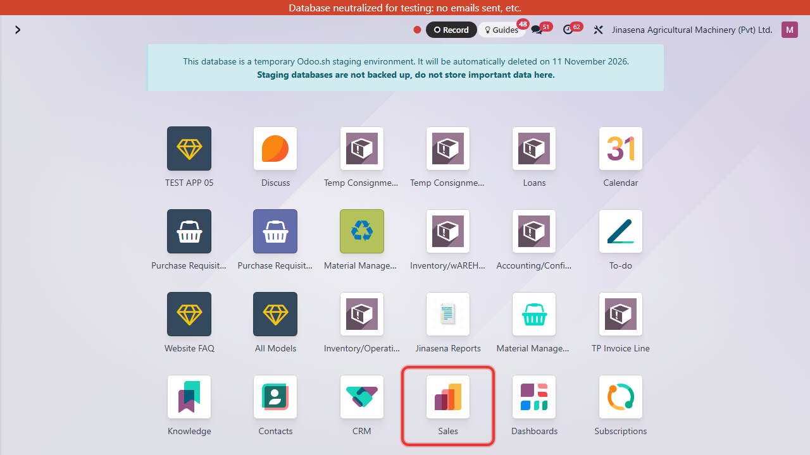

---

## 2. Click Orders in the top menu to see the order options

Look at the menu bar at the top of the Sales screen (Orders, To Invoice, Products, Reporting, Configuration). Click **Orders**. A small dropdown opens below it.

_Why: the Orders menu groups quotations, sales orders and customers. Check: the dropdown shows Quotations and Orders._

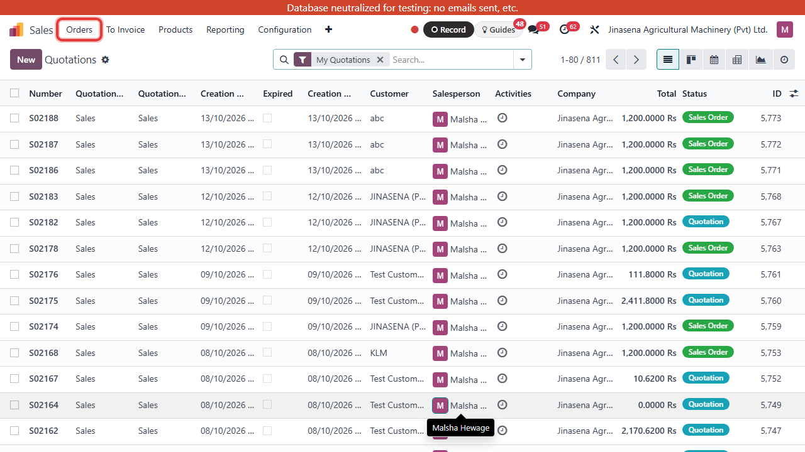

---

## 3. Click Quotations to open the list of all existing quotations

In the dropdown, click **Quotations**. A list opens showing the quotations that already exist, with the customer, date and status of each.

_Why: a quotation is the draft of a sale. It becomes a Sales Order only after you click Confirm. Check: the list shows existing quotations with their status._

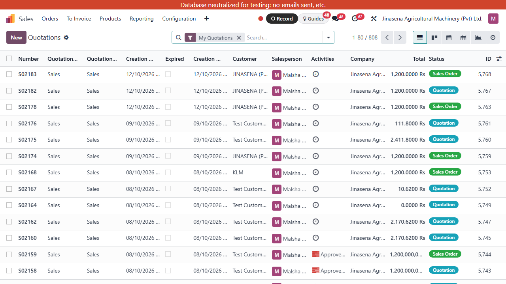

---

## 4. Click New to start a blank quotation for the cash customer

At the top left of the list, click the purple **New** button. A blank quotation form opens, and its title shows "New" until you save it.

_Why: a new form opens with number "New". The real number (for example S02213) is only given when you save. Tip: do not click Confirm yet, because the fields below must be filled first._

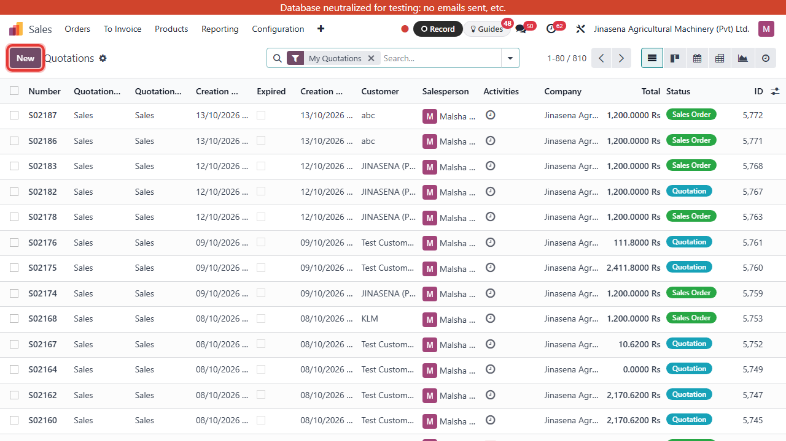

---

## 5. Click the Customer field and type the customer's name to search for them

On the form, find the **Customer** field near the top left. Click it and type the customer's name, or part of it. A list of matching customers appears below the field.

_Why: Odoo needs a customer to price the order and print the invoice. Tip: type at least 3 letters. You can search by name, phone or code. Watch out: if the customer does not exist, create them first (see the Create a Cash Customer manual)._

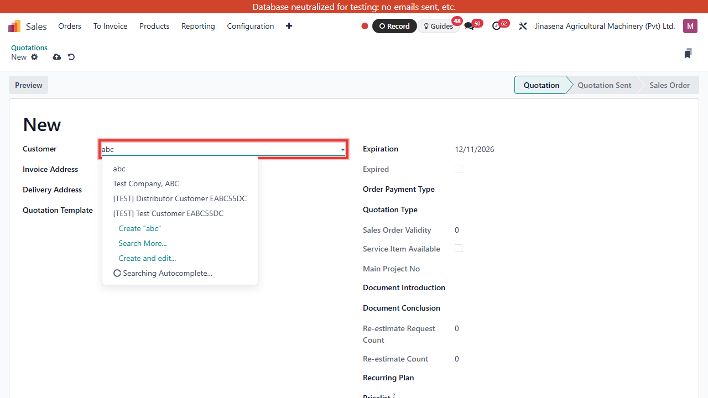

---

## 6. Select the correct customer from the search results list

Look through the list and click the **correct customer**. The name now shows in the Customer field, and the Invoice Address and Delivery Address fill in by themselves.

_Check: the selected name appears in the field, and the Invoice Address and Delivery Address fill in automatically. Wrong customer? Click the field again and choose another one before saving._

---

## 7. Set Order Payment Type to Cash because the customer pays immediately

Find the **Order Payment Type** field. Click it and choose **Cash** from the choices. Choose Cash because the customer pays at the time of sale.

_Why: Cash tells Odoo the customer pays immediately, and it drives the invoice and payment steps at the end. Watch out: choosing Credit instead changes the later steps._

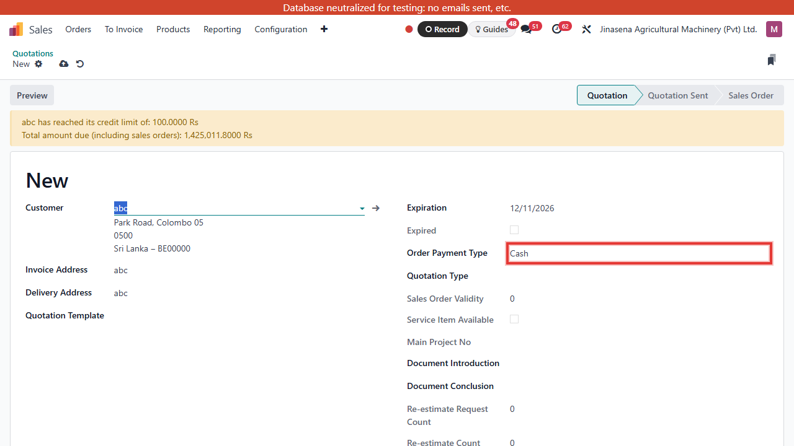

---

## 8. Set Quotation Type to Sales to mark this as a normal product sale

Find the **Quotation Type** field below it. Click it and choose **Sales**. This marks the order as a normal sale of products.

_Why: the Quotation Type separates normal sales from other order kinds (for example repairs or projects). Choose Sales for an ordinary product sale. Watch out: a wrong type can send the order to the wrong reports._

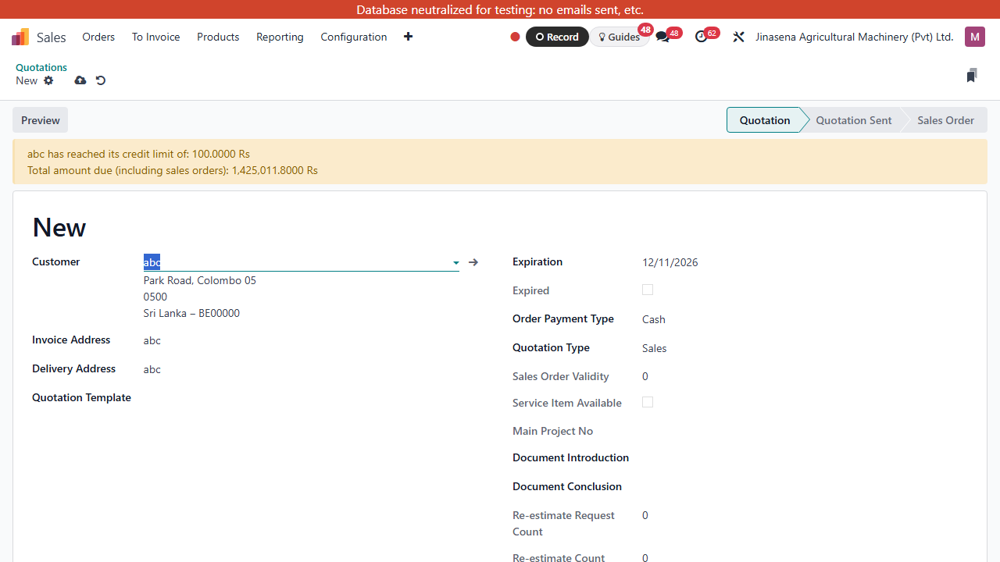

---

## 9. Click Add a product to add a new row to the order lines

Scroll down to the **Order Lines** table. Click the blue **Add a product** link at the bottom of the table. An empty row appears, ready to fill.

_Why: each row is one product. Tip: you can add several products by clicking Add a product again. Check: a new empty row appears in the order lines table._

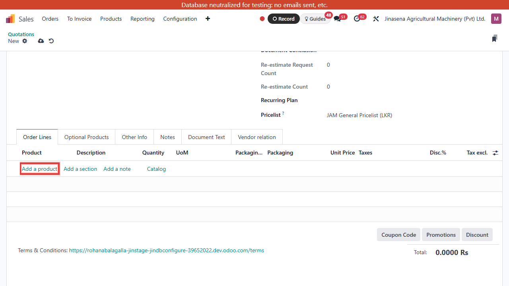

---

## 10. Type the product name or code in the new row to search for the product

In the empty row, click the **Product** cell and type the product's name or code (for example 02BB 023). A list of matching products opens below the cell.

_Tip: you can type the product code or part of the name. Watch out: if the product list is empty, the product may be archived or not sellable (Can be Sold is off)._

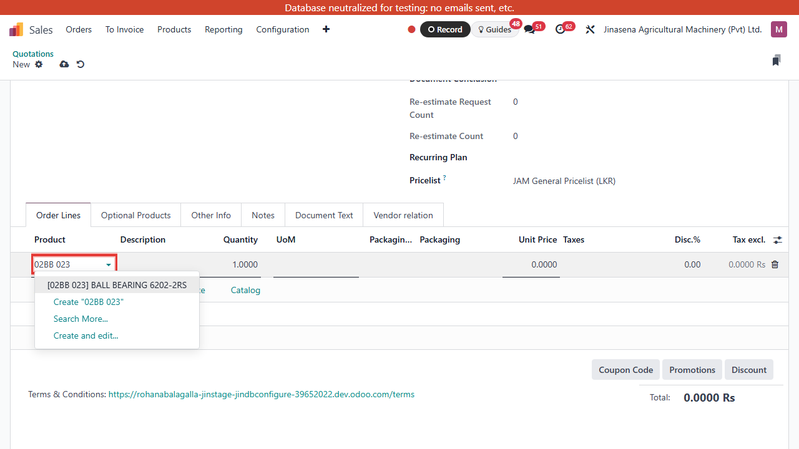

---

## 11. Select the correct product from the search results

Click the **correct product** in the list, for example [02BB 023] BALL BEARING 6202-2RS. Its description and unit price fill in on the row.

_Check: the product name, description and unit price fill in on the row. Watch out: if an error such as "no matching analytic account" appears, the product's category has no analytic account in the Product Group plan. Ask accounting to set the account's Product Category._

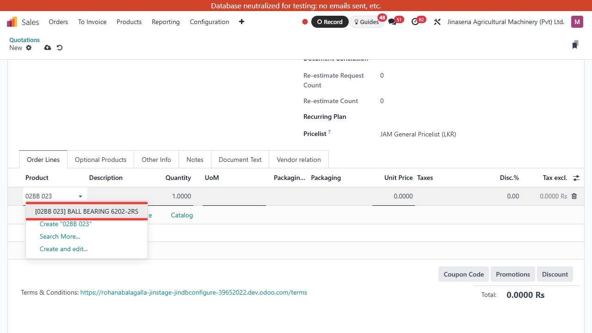

---

## 12. Check the Quantity and change it if the customer is buying more than one

Look at the **Quantity** column on the same row. It starts at 1. Click the cell and type another number if the customer is buying more. The line total updates by itself.

_Why: the quantity decides the price and what the delivery must hand over. Check: the line total (quantity x unit price) updates. Watch out: serial-tracked products need one serial number per unit, so keep the quantity at the number of serials you have in stock._

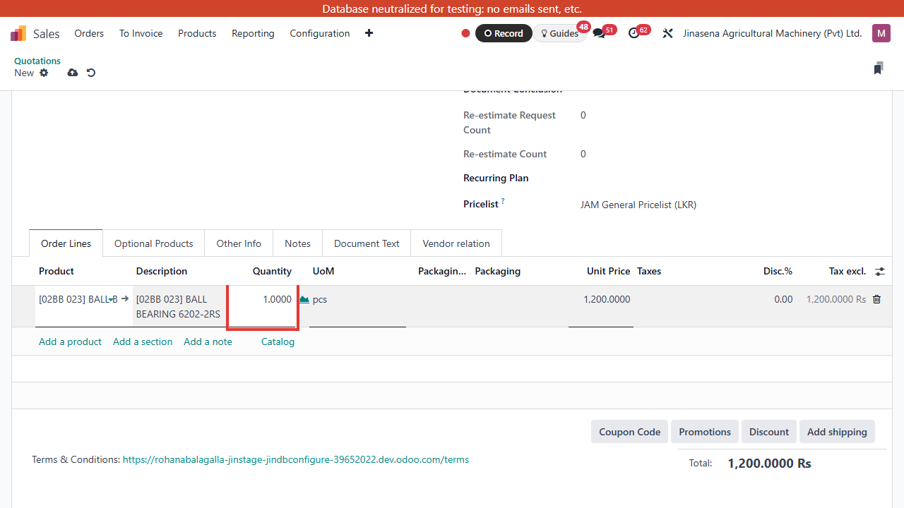

---

## 13. Open the Other Info tab to fill in the payment, sales team and warehouse details

Below the order lines, find the row of tabs (Order Lines, Optional Products, Other Info). Click the **Other Info** tab. It shows the payment, sales team and delivery fields.

_Important: in the next steps (14 to 21) the Payment Terms, Sales Team and Warehouse fields are usually filled in automatically by Odoo. Do not skip them. Check: look at each field and confirm the value is correct for this sale (Payment Terms = Immediate Payment, your own Sales Team, the warehouse that holds the stock). If a value is already correct, leave it and go to the next field. If it is empty or wrong, follow steps 14 to 21 to change it. Watch out: a wrong warehouse or team is the most common mistake, and it only shows up later on the delivery and the reports._

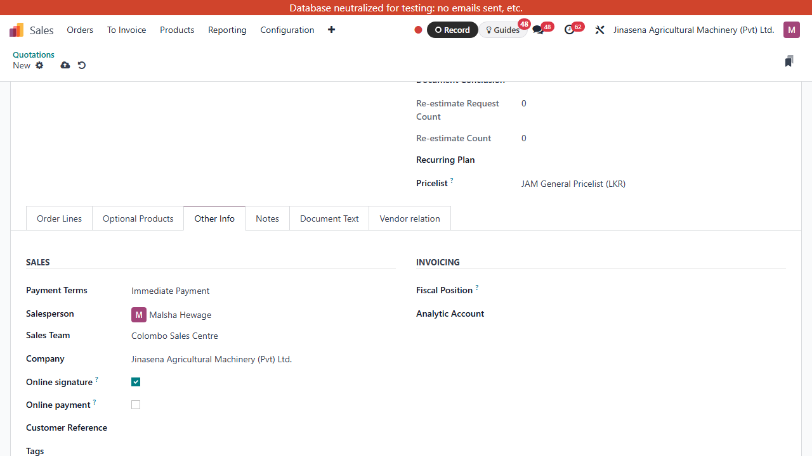

---

## 14. Click the Payment Terms field to see the available payment terms

In the **Payment Terms** field, click once. A list of payment terms opens (for example Immediate Payment, 30 Days, 90 Days).

_Why: payment terms decide when the customer must pay. Tip: the list shows only a few options, so type to search if yours is not listed._

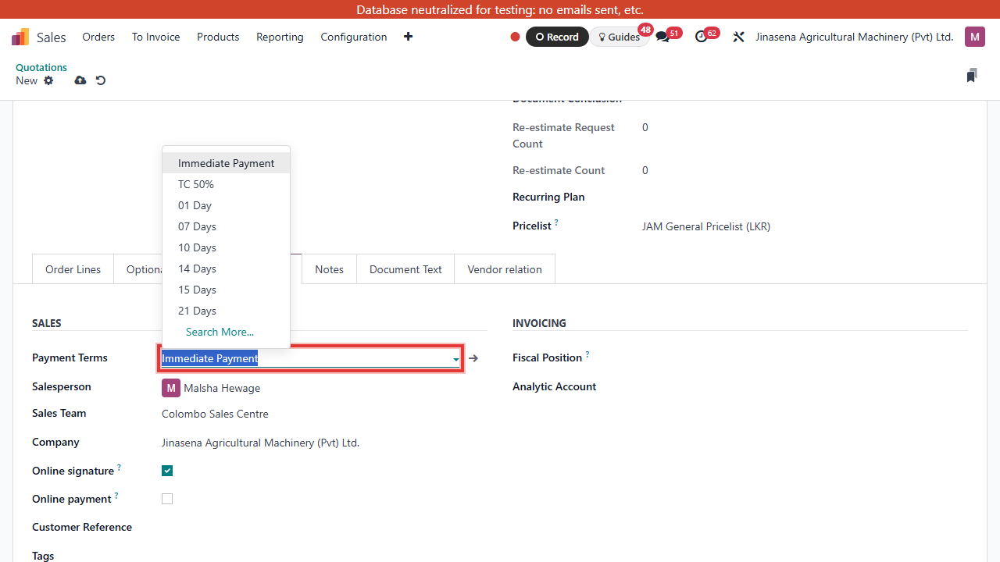

---

## 15. Select Immediate Payment because a cash sale is paid straight away

Click **Immediate Payment** in the list. Do not choose terms such as "90 Days", because those create a credit sale and not a cash sale.

_Why: a cash sale is paid on the spot, so the invoice is due immediately. Watch out: terms like "90 Days" would create a credit invoice and break the cash flow._

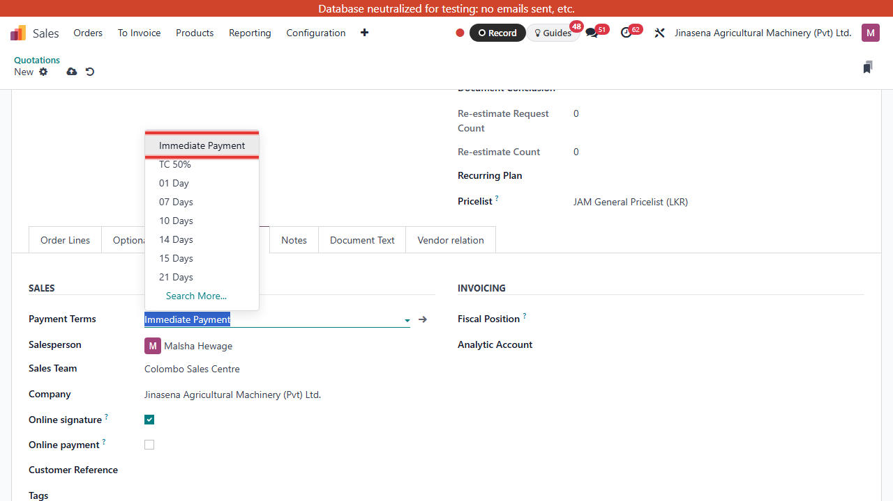

---

## 16. Click the Sales Team field to choose the team that is making this sale

Find the **Sales Team** field and click it. A short list of teams opens. If your team is not in the list, use the next step.

_Why: the team groups the order for sales reports and targets. Tip: the field may already hold your default team, and you can leave it if it is correct._

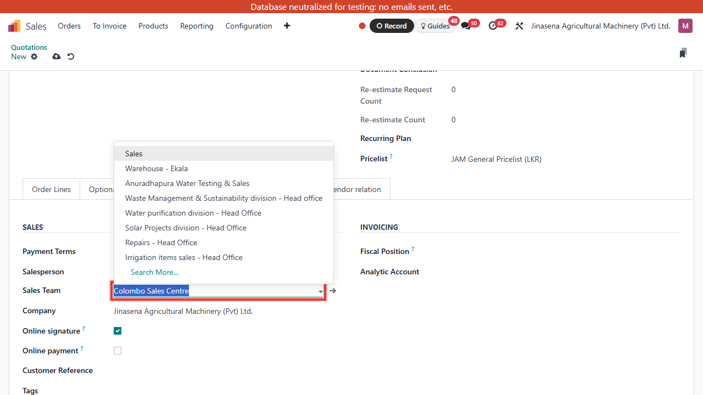

---

## 17. Click Search More... to see the full list of sales teams

At the bottom of the short list, click **Search More...**. A window opens with all sales teams, so you can find yours quickly.

_Why: the short dropdown shows only a few teams. Search More... opens the full list in a window, where you can also search and filter._

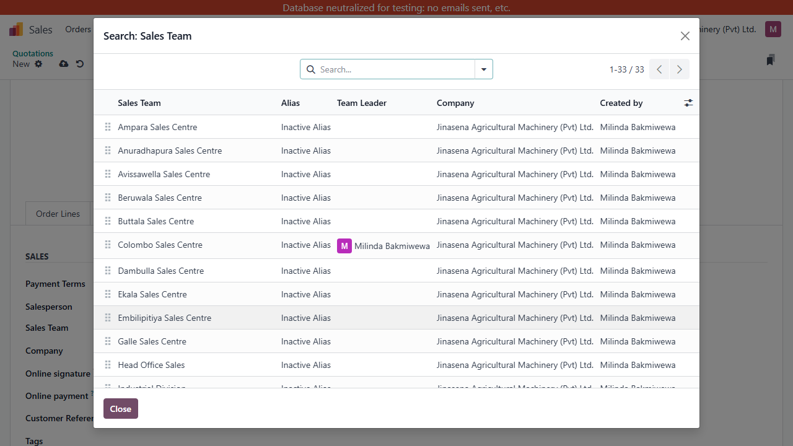

---

## 18. Select your own sales team from the list

In the window, click **your own sales team** (for example Colombo Sales Centre). The window closes and the team name shows in the field.

_Check: the team name shows in the field after the window closes. Watch out: choose the team for the branch that is making the sale, because reports and commissions use it._

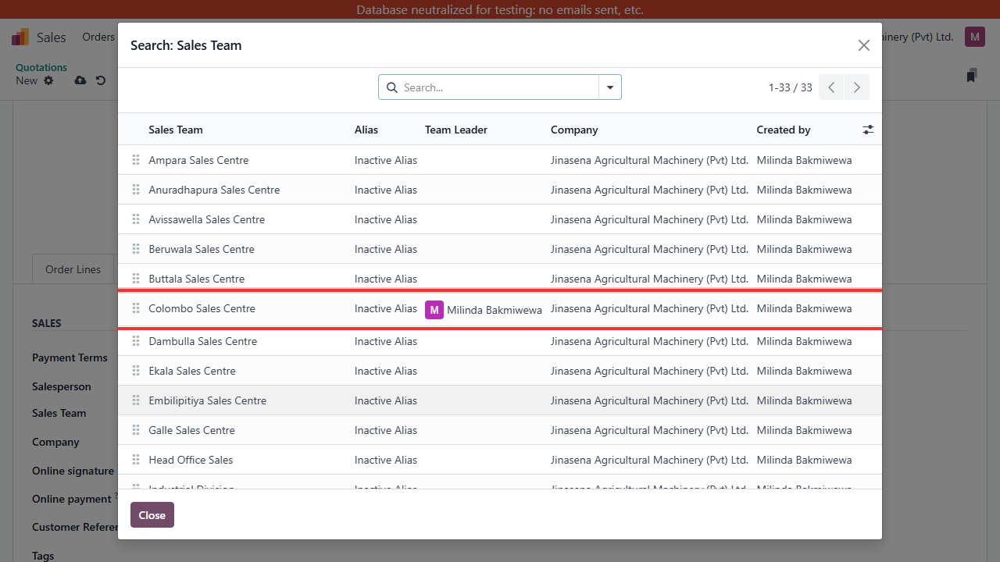

---

## 19. Click the Warehouse field to choose where the goods will be shipped from

Find the **Warehouse** field in the same tab and click it. A short list of warehouses opens. The warehouse is the place the goods will leave from.

_Why: the warehouse is where Odoo reserves and ships the stock from. Watch out: the wrong warehouse means the delivery is created in the wrong branch, and the stock may not be available._

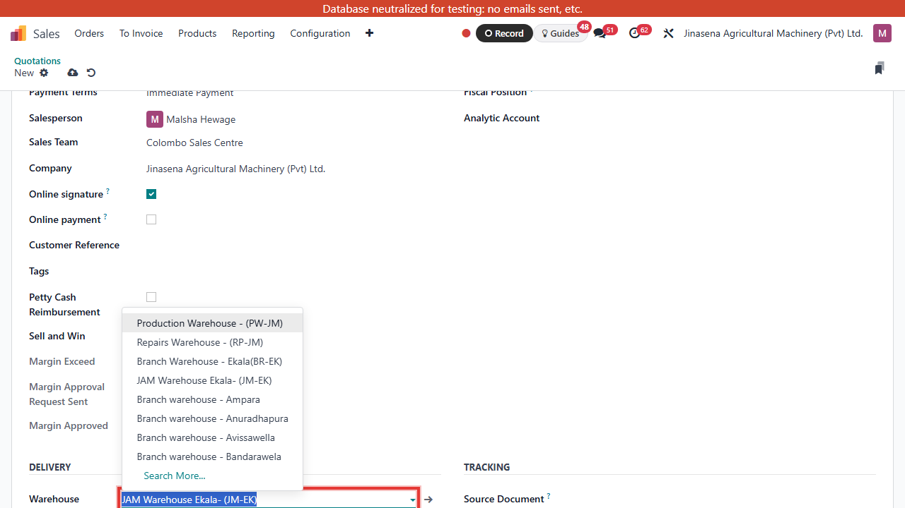

---

## 20. Click Search More... to see the full list of warehouses

At the bottom of the list, click **Search More...** to open the window with all warehouses.

_Why: same as for the team, the full list helps you find the right branch quickly._

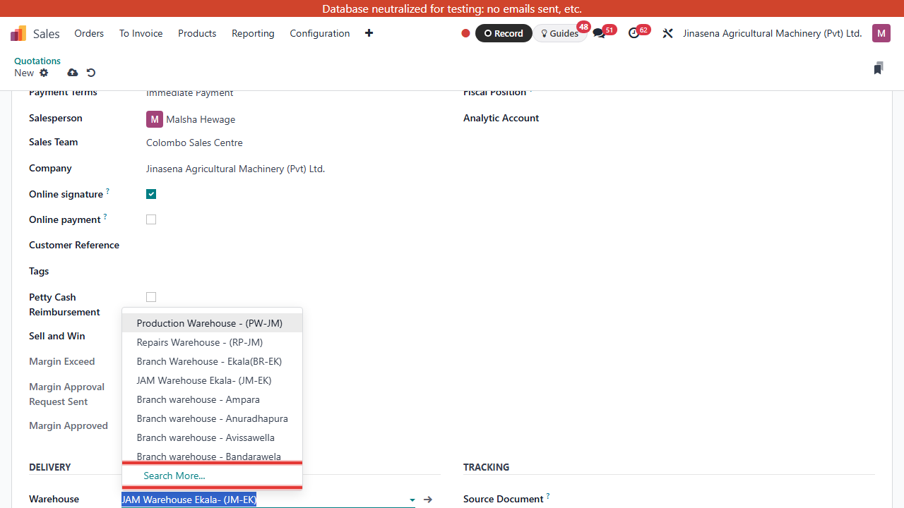

---

## 21. Select the correct warehouse so the stock is taken from the right branch

Click **the warehouse that holds the stock** (for example JAM Warehouse Ekala- (JM-EK)). The window closes and the name shows in the Warehouse field.

_Check: the warehouse name appears in the field. The product must be in stock here, or the delivery cannot be validated (a serial-tracked product also needs its serial number in this warehouse)._

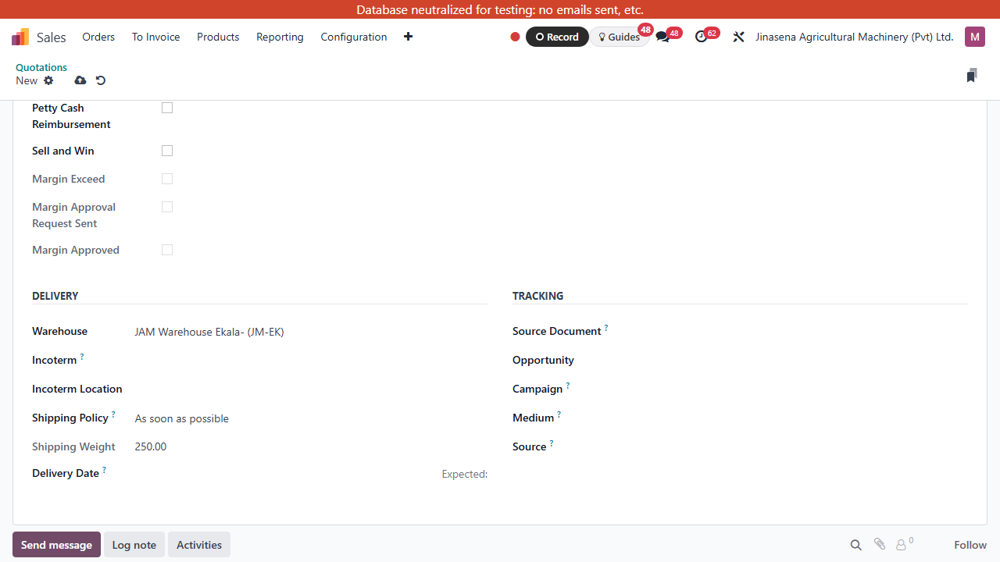

---

## 22. Click Confirm to turn the quotation into a confirmed Sales Order

Scroll to the top of the form. In the header, click the purple **Confirm** button. The status bar moves from Quotation to Sales Order, and new buttons such as **Delivery** appear.

_Why: confirming turns the quotation into a Sales Order and creates the delivery. Check: the status bar moves to Sales Order and a Delivery button appears. Watch out: if a purchase error such as "no matching vendor price" appears, the product's route is Buy / Make to Order and its Purchase tab needs a vendor line with a valid price and dates._

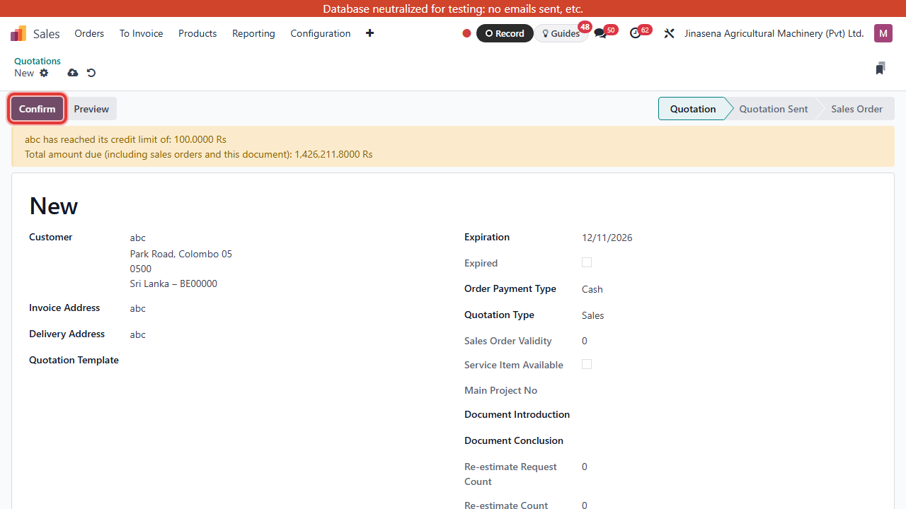

---

## 23. Click the Delivery button at the top of the order to open the delivery document

At the top of the sales order, click the **Delivery** smart button (a small box icon with a number). The delivery document opens, and its status should show Ready.

_Why: the delivery is the stock document that moves the goods out of the warehouse. Check: the delivery shows status Ready. If it is Waiting, the stock is not available yet._

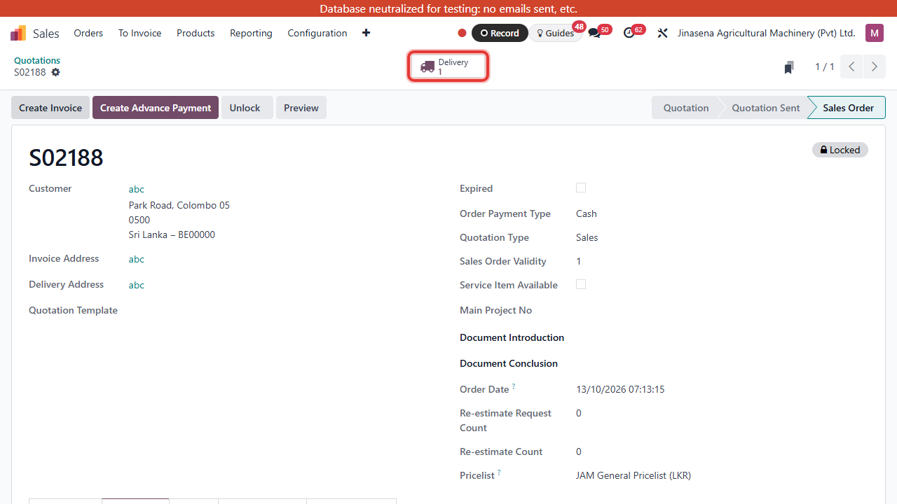

---

## 24. Click Validate on the delivery to confirm the goods were handed over to the customer

In the header of the delivery, click the purple **Validate** button. Odoo records that the goods have left the warehouse, and the status changes to Done.

_Why: validating tells Odoo the goods have left the warehouse, and it reduces the stock. Watch out: a serial-tracked product asks for a Lot/Serial Number in Detailed Operations. If a locked order blocks validation ("Analytic Distribution"), open the sales order, click Unlock, then validate again._

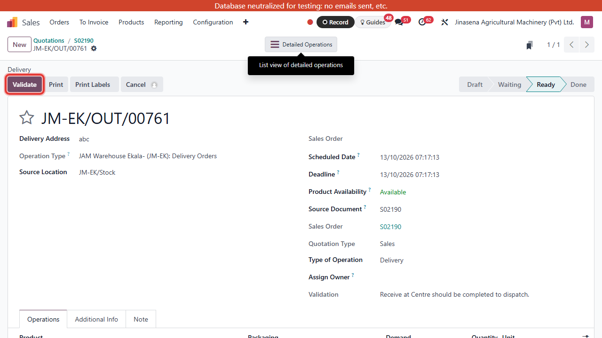

---

## 25. Click the order number at the top to go back to the sales order

At the top left, click the **order number** (for example S01881) in the breadcrumb trail. You go back to the sales order.

_Why: the invoice is created from the sales order, not from the delivery. Check: the order now shows the Delivered quantity on its lines._

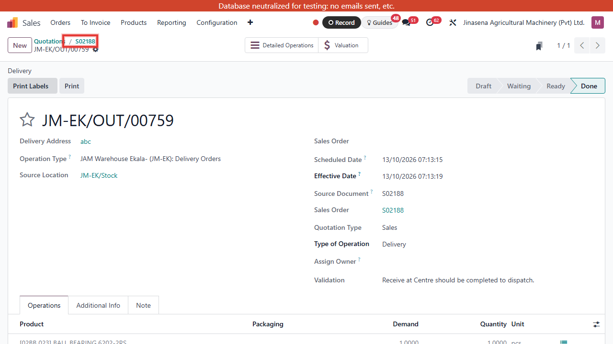

---

## 26. Click Create Invoice on the sales order to start billing the customer

In the header of the sales order, click **Create Invoice**. A small window opens that asks how you want to invoice.

_Why: this starts the billing wizard for the delivered goods. Check: a window opens that asks how to invoice._

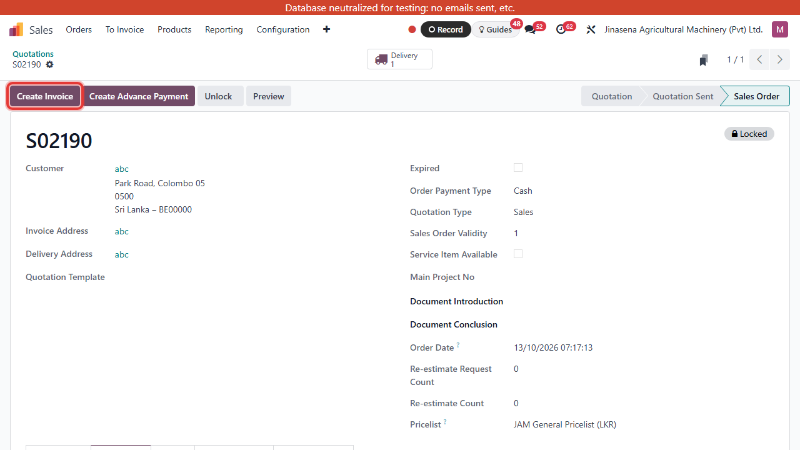

---

## 27. Click Create Invoice again in the pop-up window to confirm and create the invoice

In the window, leave the default option (Regular invoice) and click **Create Invoice**. A draft invoice opens. If you see a **Confirm** button on it, click it so that the invoice is posted.

_Why: the default option Regular invoice is correct for a cash sale. Check: a draft invoice opens. Tip: check the amounts and the customer before going on._

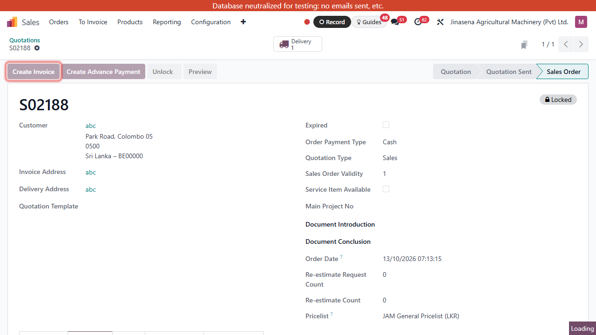

---

## 28. Click Register Payment on the invoice to record the cash received from the customer

In the header of the invoice, click **Register Payment**. A window opens where you enter how the customer paid.

_Why: the invoice is only marked paid after a payment is recorded. Check: the invoice must be confirmed (posted) first. If you see a Confirm button, click it before registering the payment._

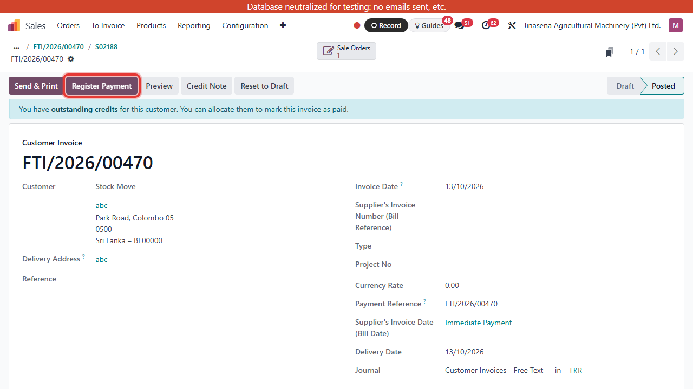

---

## 29. Click the Journal field to choose where the payment will be recorded

In the window, click the **Journal** field. A short list of journals (cash and bank accounts) opens.

_Why: the journal decides which account receives the money. For a cash sale it must be a cash journal, not a bank journal._

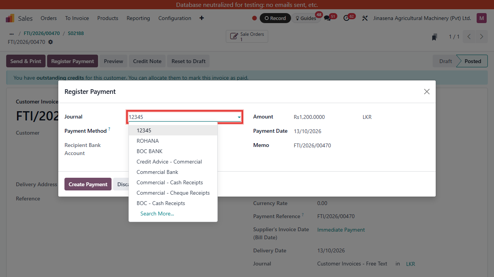

---

## 30. Click Search More... to see the full list of journals

At the bottom of the list, click **Search More...** to see every journal.

_Why: the dropdown may not list every journal, so Search More... shows the full list._

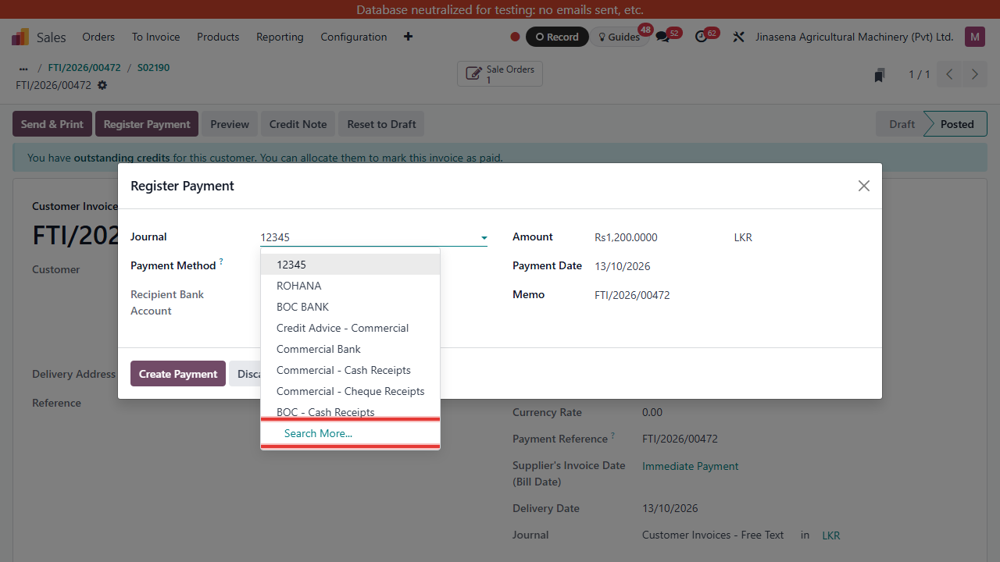

---

## 31. Select Customer Receipts - Cash as the journal for this cash payment

Click **Customer Receipts - Cash**. Check that the Amount equals the invoice total.

_Check: the Journal field shows Customer Receipts - Cash, and the amount equals the invoice total. Watch out: choosing a bank journal posts the money to the bank account instead._

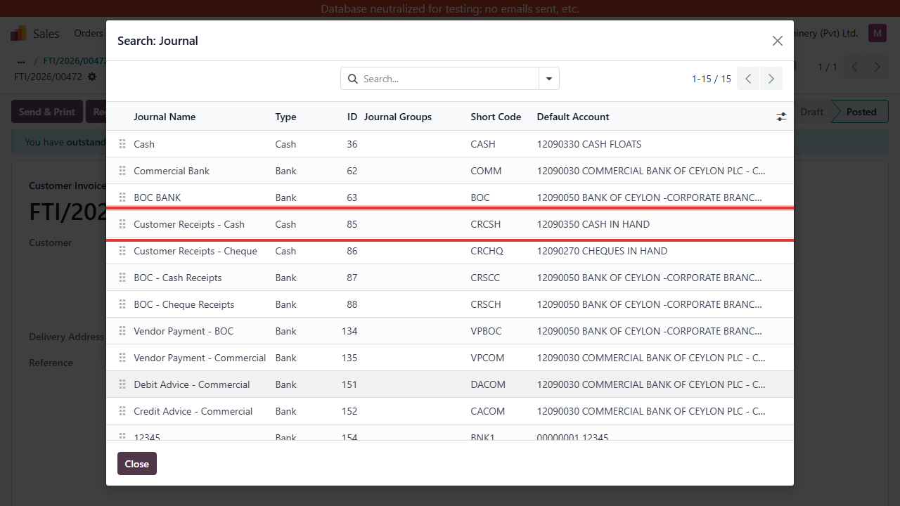

---

## 32. Click Create Payment to finish, and the invoice is now paid

Click the purple **Create Payment** button. The window closes and the invoice is now paid.

_Why: this posts the payment and links it to the invoice. Check: the window closes and the invoice status changes to In Payment or Paid._

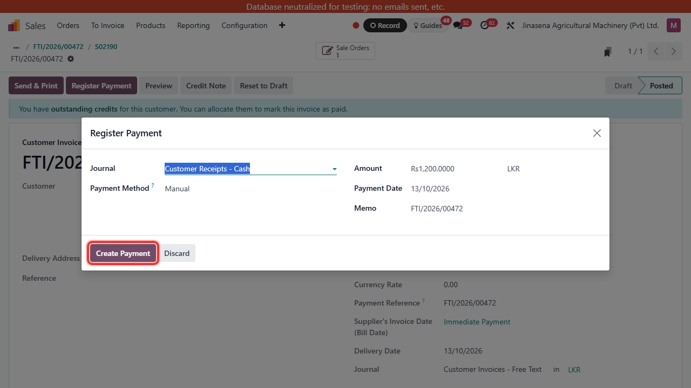

---

## 33. Click the Sale Orders button to go back to the sales order

At the top of the invoice, click the **Sale Orders** smart button. You go back to the sales order.

_Why: the order and the invoice are linked, so you can move between them. Check: the sales order shows the status Fully Invoiced._

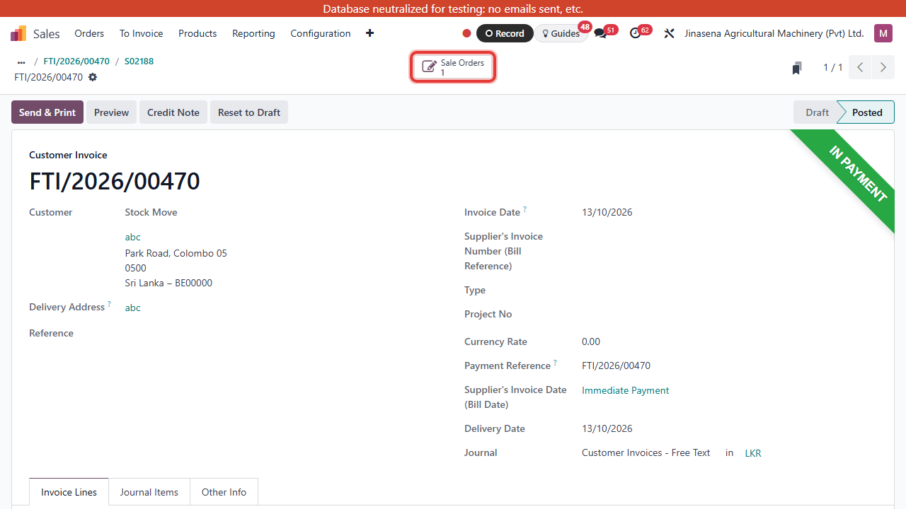

---

## 34. Click the Invoices button to open the invoice and check it one last time

On the sales order, click the **Invoices** smart button to open the invoice again and check it one last time.

_Why: a last look confirms that everything is consistent: customer, amounts and status._

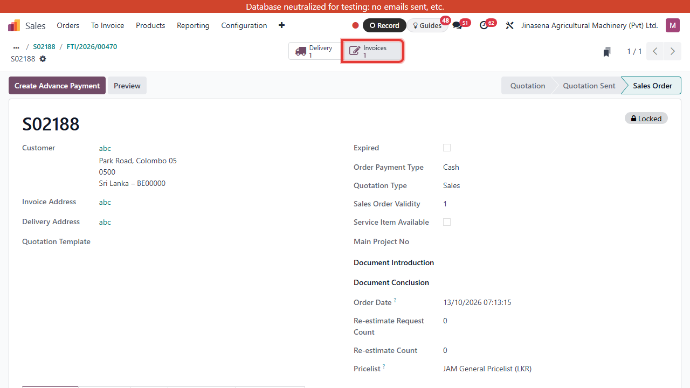

---

## 35. Check the green In Payment ribbon, which shows the cash sale is complete

Look at the top right of the invoice. A green **In Payment** ribbon means the payment has been recorded. The cash sale is now complete.

_Result: the cash sale is complete: order confirmed, goods delivered, invoice issued and payment recorded. Check: the green In Payment ribbon is on the invoice, and the order's smart buttons show one delivery and one invoice._

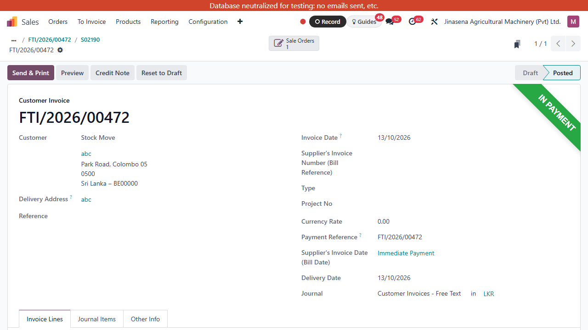

---

