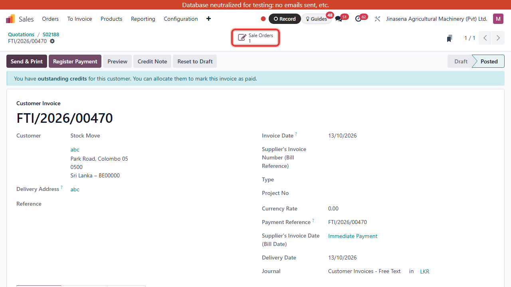

# Cash Sales Order — User Manual (English)

New Sales Order

Generated from an Odoo Tour Recorder export, replayed with Playwright, and screenshotted at every step.

---

## 1. Open Sales

Click the Sales module

---

## 2. Orders

Click the Orders

---

## 3. Quotations

Click the Quotations

---

## 4. New

Click the New button

---

## 5. Find the customer

Find a customer...

---

## 6. Select the customer

Select a customer

---

## 7. Order Payment Type

Select Cash

---

## 8. Quotation Type

Select Sales

---

## 9. Add a product

Click Add a product

---

## 10. Search the product

Search the product

---

## 11. [02BB 023] BALL BEARING 6202-2RS

Add the product

---

## 12. Quantity

Set the quantity

---

## 13. Other Info

Click Other Info

---

## 14. Payment Terms

Click Payment Terms

---

## 15. Immediate Payment

Click Immediate Payment because this is a cash order

---

## 16. Sales Team

Click the Sales Team

---

## 17. Search More...

Click Search More

---

## 18. Colombo Sales Centre

Click Colombo Sales Centre

---

## 19. Warehouse

Click Warehouse

---

## 20. Search More...

Click Search More

---

## 21. JAM Warehouse Ekala- (JM-EK)

Click JAM Warehouse Ekala- (JM-EK)

---

## 22. Confirm

Click the Confirm button

---

## 23. Delivery

Click the Delivery smart button

---

## 24. Validate

Click the Validate button

---

## 25. Back to the sales order

Back to the sales order

---

## 26. Create Invoice

Click Create Invoice

---

## 27. Confirm

Click Confirm

---

## 28. Sale Orders

Click the Sale Orders smart button

---

## 29. Invoices

Click the Invoices smart button

---

## 30. Register Payment

Click Register Payment

---

## 31. Journal

Click the bank journal field

---

## 32. Search More...

Click Search More

---

## 33. Customer Receipts - Cash

Select Customer Receipts - Cash

---

## 34. Create Payment

Click Create Payment

---

## 35. Sale Orders

Click the Sales Order smart button

---

## 36. Invoices

Click the Invoices smart button

---

